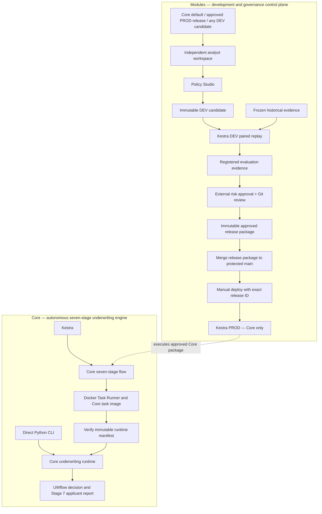

<h1 align="center">


</h1>

<div align="center">

**Governed Underwriting Orchestration**<br />**End-to-End Credit Decision Pipeline with AIDflow Inference**

<p>
  <a href="https://www.python.org/downloads/"></a>
  <a href="https://docs.python.org/3/library/venv.html"></a>
  <a href="https://nodejs.org/"></a>
  <a href="https://fastapi.tiangolo.com/"></a>
  <br />
  <a href="https://react.dev/"></a>
  <a href="https://kestra.io/"></a>
  <a href="https://www.docker.com/"></a>
  <a href="https://docs.astral.sh/ruff/"></a>
  <br />
  <a href="https://docs.pytest.org/"></a>
  <a href="LICENSE"></a>
  <a href="core/LICENSE"></a>
  
</p>

</div>

<div align="center">

*Synthetic demonstration. Not for use in real credit decisions.<br>All bureau and alternative-data responses are deterministic simulations.*<br />


[](https://github.com/aigensys-labs/uwflow/blob/main/docs/assets/uwflow-preview.gif)

**Kestra orchestrates. AIDflow scores. UWflow decides. Provenance follows.**

</div>

> **Synthetic demonstration only.** All bureau and alternative-data responses are deterministic simulations. The included weights, thresholds and prices are illustrative and have not been trained, calibrated, independently validated or approved for real lending. Do not use this project to make real credit decisions.

UWflow is the end-to-end underwriting platform. It owns application intake, workflow orchestration, eligibility, bureau policy, affordability, pricing, decision routing, reporting and execution provenance. AIDflow is a separately versioned scoring/inference component: it consumes ten normalized big-data scores and returns one complex customer-profile score to UWflow.

UWflow has two product layers:

- **Core** is a complete seven-stage underwriting system. It runs independently through Kestra or directly from Python. (Apache license)
- **Modules** provide the development and governance capabilities around Core: policy authoring, immutable candidates, historical evidence, paired evaluation, comparative reporting and controlled production release. (FSL - Apache license)

Modules do not replace Core or participate in the live seven-stage production execution path. Core does not require them to make an underwriting decision.

## Core and Modules



```text
UWflow
│
├── CORE — independently runnable seven-stage UW engine
│   ├── Kestra Docker hosting and Docker Task Runner integration
│   ├── Core Python task image, bootstrap and runtime verification
│   ├── Seven-stage underwriting runtime and baseline policies
│   ├── Baseline DEV flow and production execution-flow contract
│   ├── Direct Python runner (same decision logic, all seven stages)
│   └── Basic applicant outputs: JSON, HTML and PDF
│
└── MODULES — the complete underwriting platform built on Core
    ├── Policy Studio       visual policy authoring and validation
    ├── Lifecycle           independent workspaces and immutable DEV candidates
    ├── History             datasets, snapshots, storage and connectors
    ├── Evaluation          paired champion–challenger replay
    ├── Reporting           comparative portfolio impact reports
    ├── Production          approvals, release assembly and deployment
    └── Platform Runtime    optional dependencies for module tasks
```

The repository root is stable: it contains the source tree, configuration, docs, tests and tooling. Running Core, Studio, replay, dry-run or production lifecycle operations creates data only beneath `var/`; it does not add sibling folders to the repository root.

The stable top-level directory layout is:

```text
repository-root/
├── .github/
├── core/
├── docs/
├── modules/
├── tests/
├── tools/
└── var/       all local runtime and lifecycle-managed data
```

RUNTIME STATE — all repository-local operational data stays under one root:

```text
var/
├── venv/                         managed local Python environment
├── cache/                        local tool caches
├── build/ and dist/              generated Python package build output
├── workspaces/strategies/        mutable analyst workspaces
├── artifacts/                    DEV candidates, replay flows, bundles and evidence
├── releases/approved/            immutable approved production packages
├── deployments/production/       current release pointer and deployment provenance
├── reports/                      Core applicant reports and local comparison reports
├── data/history/                 local historical datasets and file-backed history data
└── operator-state/               local workflow selections and recovery markers
```

## Choose your run path

Start with one of these three paths. The first runs the original underwriting Core only. The other two prepare the complete UWflow platform.

| Goal | Start here | What you will complete |
|---|---|---|
| **Run Core only** | [Core first-run guide](core/kestra/README.md) | Prepare the minimal Core Python environment, run the seven stages locally, then deploy and execute the same Core flow in Kestra. No platform Modules or History services are required. |
| **Run the full platform — fast** | [DEV Fast Route](docs/development/dev-fast-route.md) | Prepare the complete local stack, run the Core smoke test and paired replay, then start Policy Studio. |
| **Run the full platform — detailed** | [End-to-end DEV workflow](docs/development/end-to-end-dev-workflow.md) | Follow the complete setup and validation sequence, create or reuse historical evidence, run paired replay and make a controlled policy change. |

### Quick Core execution with Python

After preparing the Core environment in the [Core first-run guide](core/kestra/README.md), run the default synthetic application:

```bash
python -m core.python.cli
```

To choose an application and output directory:

```bash
python -m core.python.cli --input core/underwriting/examples/applications/application_default.json --output-dir var/reports
```

Reports are written to `var/reports/` by default, keeping generated output out of the repository root. This path does not start Kestra, Docker, Policy Studio, PostgreSQL or any platform module. It uses the same Core underwriting runtime and decision logic as the seven-stage Kestra flow. The included applications and outcomes are synthetic demonstrations, not lending evidence.

## The seven Core stages

1. **Input validation and hard gates** — validate the application and apply the base eligibility policy.
2. **Bureau assessment** — retrieve the configured bureau response and apply the bureau assessment logic.
3. **Consent and source planning** — evaluate consent and produce a typed plan for permitted sources.
4. **Alternative-data execution** — execute the planned source adapters.
5. **AIDflow inference** — produce the customer-profile score and diagnostics.
6. **UWflow decision** — apply the decision policy, affordability, counteroffer and pricing logic.
7. **Applicant report** — render the resulting decision as JSON, HTML and PDF.

The same Core runtime is used by the direct Python runner and the Kestra reference flow. Kestra owns task order, dependencies, retries, parallel source execution and execution history; Python executes the domain logic; UWflow owns the final decision; AIDflow scores but does not decide.

## What Modules add

Each link below opens the module's operator landing page. That page explains the module's responsibility and boundaries, then links directly to the practical guides for using it. You should not need to visit a short description and then search another index for the actual procedure.

| Module | What it adds | Operator entry point |
|---|---|---|
| Policy Studio | Analyst workspaces, typed policy editing, validation, preview and local candidate preparation. | [modules/policy-studio/](modules/policy-studio/README.md) |
| Lifecycle | Workspace ancestry, immutable DEV candidates and exact runtime/strategy provenance. | [modules/lifecycle/](modules/lifecycle/README.md) |
| History | Historical datasets, point-in-time evidence, PostgreSQL/Parquet connectors and snapshots. | [modules/history/](modules/history/README.md) |
| Evaluation | Paired champion–challenger replay over the same frozen evidence. | [modules/evaluation/](modules/evaluation/README.md) |
| Reporting | Comparative decision, score, segment, source-coverage and migration reports. | [modules/reporting/](modules/reporting/README.md) |
| Production | Approval evidence, immutable release assembly, provenance and protected deployment. | [modules/production/](modules/production/README.md) |
| Platform Runtime | Optional task-image dependencies for platform tasks; not needed by Core. | [modules/platform-runtime/](modules/platform-runtime/README.md) |

## Images and dependencies

- `ai/uwflow-core-runtime:2.0.0` is sufficient for the seven-stage Core Kestra flow. It contains the Kestra Python adapter and the Core Stage 7 PDF dependency.
- `ai/uwflow-runtime:2.0.0` extends the Core image with optional History/Evaluation dependencies such as SQLAlchemy, PostgreSQL and PyArrow.

Build only Core with `bash tools/docker/build-images.sh --core-only`. Build Core and the optional platform image with `bash tools/docker/build-images.sh`.

The immutable Core application runtime is published to Kestra Namespace Files and selected by the flow. It is not baked into the Docker image.


## Documentation

The module landing pages above are the operator entry points for their respective capabilities. The [documentation index](docs/README.md) brings together the run paths, Module entry points and engineering references. The [Core and Modules architecture](docs/architecture/core-and-modules.md) explains the ownership boundary. The [UWflow lifecycle and storage model](docs/architecture/lifecycle-and-storage.md) is the authoritative reference for workspaces, candidates, evaluations, approved releases and production deployments.

## Repository map

| Path | Responsibility |
|---|---|
| `core/docker/` | Core task image and generic Kestra Python bootstrap. |
| `core/kestra/` | Kestra launcher, seven-stage baseline flow, production execution flow and immutable Core runtime releases. |
| `core/python/` | Core Python runtime source and seven-stage direct CLI. |
| `core/underwriting/` | Core-owned canonical baseline policies, schema, examples and runtime bundle tooling. |
| `modules/` | Optional platform capabilities built on Core. |
| `tools/` | Operator commands, Core utilities and shared integration adapters. |
| `docs/` | Product, operator and engineering guides. |
| `tests/` | Automated execution, module and repository contract tests. |


## License

Modules are licensed under **FSL 1.1 (Apache 2.0 Future License)** — see [LICENSE](LICENSE).

The `core/` directory is licensed under **Apache 2.0** — see [core/LICENSE](core/LICENSE).
UWflow trademarks/branding and separately owned IP are not granted by either license.

## Citation

```bibtex
@software{UWflow,
  author = {Michal Ricar, PhD},
  year = {2026},
  publisher = {AIGENSYS s.r.o.},
  title = {UWflow: Governed Underwriting Orchestration with AIDflow Inference},
  url = {https://github.com/aigensys-labs/uwflow}
}
```