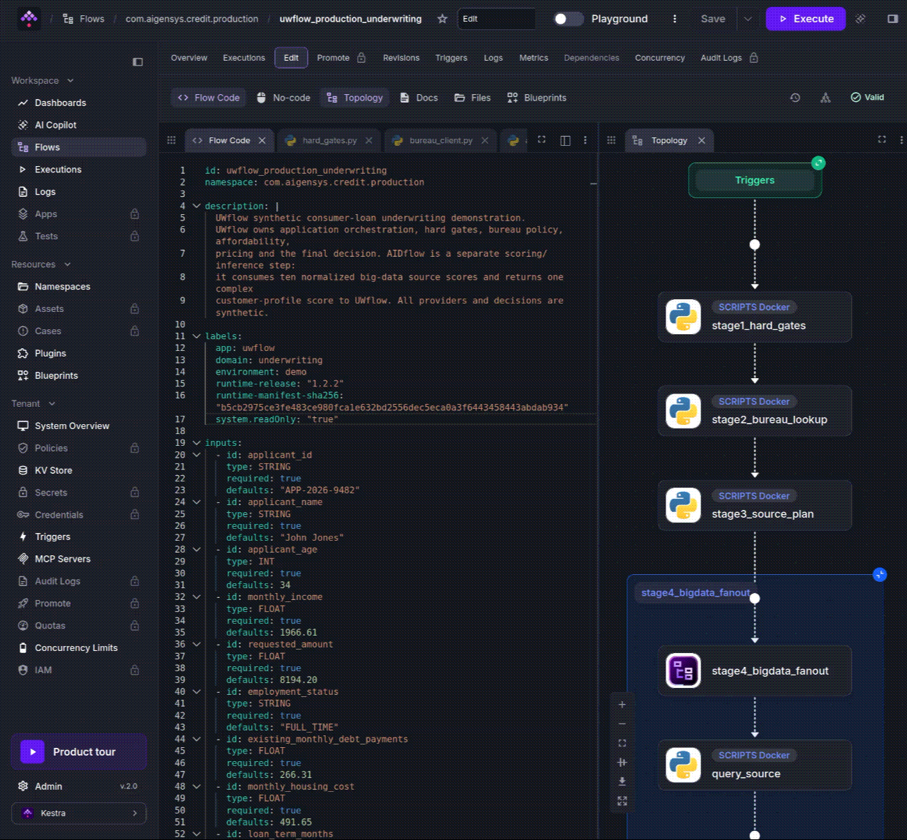
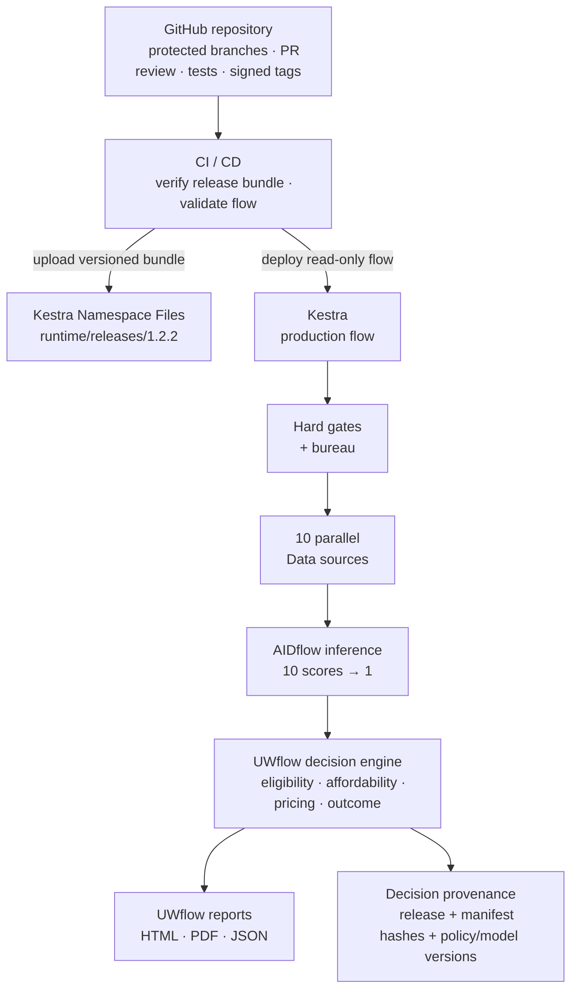

<h1 align="center">


</h1>

<div align="center">

**Governed Underwriting Orchestration**<br />**End-to-End Credit Decision Pipeline with AIDflow Inference**

[](https://www.python.org/)
[](https://kestra.io/)
[](https://www.apache.org/licenses/LICENSE-2.0)
[](https://github.com/astral-sh/ruff)

</div>

<div align="center">

*Synthetic demonstration. Not for use in real credit decisions.<br>All bureau and alternative-data responses are deterministic simulations.*<br />


[](https://github.com/aigensys-labs/uwflow/blob/main/docs/assets/uwflow-preview.gif)

**Kestra orchestrates. AIDflow scores. UWflow decides. Provenance follows.**

</div>

> **Synthetic demonstration only.** All bureau and alternative-data responses are deterministic simulations. The included weights, thresholds and prices are illustrative and have not been trained, calibrated, independently validated or approved for real lending. Do not use this project to make real credit decisions.

UWflow is the end-to-end underwriting platform. It owns application intake, workflow orchestration, eligibility, bureau policy, affordability, pricing, decision routing, reporting and execution provenance. AIDflow is a separately versioned scoring/inference component: it consumes ten normalized big-data scores and returns one complex customer-profile score to UWflow.

Kestra orchestrates the underwriting stages and stores approved runtime code as **Namespace Files**. GitHub is the source of truth for development, review, tests and releases. Production tasks load only an explicitly versioned runtime bundle from Kestra Namespace Files. No host-mounted `/app/scripts` directory is used.

> **First local run:** follow the [step-by-step guide](docs/FIRST_RUN.md). It starts Kestra, uploads the approved Python release into Namespace Files, deploys the flow and runs the John Jones example. Each step explains why it exists.

## Architecture

Full system view. The left portion (GitHub → CI/CD → Kestra) is the
production deployment pipeline. The right portion (stages 1–7) is the
underwriting decision flow.



<br>

| Component | Responsibility | Source in this repository | Production location |
|---|---|---|---|
| GitHub | Approved source, review, release and audit trail | Entire repository | GitHub |
| Kestra | Orchestration and execution history | `kestra/flows/` | Kestra flow namespace |
| Runtime modules | Python business logic and adapters | `scripts/` | Versioned Kestra Namespace Files |
| AIDflow | Dedicated customer-profile inference only | `scripts/aidflow_scoring.py` | Included in runtime release |
| UWflow | Final underwriting, policy, affordability and pricing | `scripts/uwflow_engine.py` | Included in runtime release |
| Reporting | Render final decision; never recalculates it | `scripts/report_renderer.py` | Included in runtime release |
| Release manifest | Checksums proving exact runtime module contents | Generated by `tools/build_runtime_bundle.py` | Alongside runtime files in Kestra |

### Runtime deployment boundary

- `scripts/` is the development source tree in GitHub. It is **not mounted** into the Kestra container.
- `kestra/namespace-files/runtime/releases/<version>/` is a generated, reviewed release bundle. It is committed alongside the source so the deployed artifact can be inspected and reproduced.
- CI uploads that release directory into the matching Kestra Namespace Files path. Each flow task mounts only its pinned release path using `namespaceFiles.enabled` and `include`.
- Every execution verifies `release-manifest.json` before evaluating the application. A missing or changed runtime module fails closed.
- Production flow is labelled `system.readOnly: true`; production edits go through Git and the deployment workflow, not the Kestra editor.
- Use protected, immutable release tags (`v1.2.2`, etc.) and a GitHub Environment with required reviewers. Restrict direct Namespace File write permissions to the deployment identity.


## Repository layout

```text
.
├── scripts/                         # Development source modules
├── kestra/
│   ├── flows/                       # Version-controlled Kestra flow YAML
│   └── namespace-files/
│       └── runtime/releases/1.2.2/  # Immutable deployable runtime bundle
├── tools/                           # Build and verify runtime bundles
├── tests/                           # Python and repository-contract tests
├── examples/                        # Synthetic application payloads and reports
├── docker/                          # Docker image for runtime dependencies
├── docs/                            # Architecture, deployment, audit/provenance
├── .github/workflows/               # CI and protected production deployment
├── pyproject.toml
├── LICENSE
├── SECURITY.md
└── CONTRIBUTING.md
```


## Getting started (local)

This section covers everything you need to run the project on your own machine using Docker and Kestra. No cloud services, no CI/CD, no GitHub Actions.

### Prerequisites

- Docker (compatible with your OS)
- Python 3.11+ (for local unit tests and CLI tools; optional if you only run inside Kestra)
- A terminal

### Step 1: Run the first local demo

Follow the [step-by-step guide](docs/FIRST_RUN.md) exactly. It will:

1. Start a pinned Kestra container via Docker.
2. Install `kestractl` (the Kestra CLI).
3. Upload the `immutable 1.2.2` runtime release into Kestra Namespace Files.
4. Deploy the flow into com.aigensys.credit.production.
5. Run the John Jones sample application end-to-end.

Kestra Open Source namespaces are implicit; no namespace-creation command is required.

> Note: Kestra executes tasks in isolated Docker containers using the pre-built `aigensys/uwflow-runtime:1.2.2` image, meaning local Python dependencies are not required for Kestra orchestrations.

### Step 2: Local Python development (optional)

If you want to run unit tests or CLI tools directly on your machine:

```bash
python3 -m venv .venv && source .venv/bin/activate
python -m pip install --upgrade pip
python -m pip install -e ".[dev]"

python -m pytest -q
ruff check scripts tests tools
python -m compileall -q scripts tests tools
```

### Step 3: Run synthetic applications locally

```bash
uwflow-demo
uwflow-demo --input examples/application_counteroffer.json
uwflow-demo --input examples/application_bureau_review.json
uwflow-demo --input examples/application_bureau_decline.json
uwflow-demo --input examples/application_hard_gate_decline.json
uwflow-demo --input examples/application_no_consent.json
uwflow-demo --input examples/application_income_5000_eur.json
```

### Step 4: Generate a sample report

```bash
uwflow-report --output-dir generated_reports
```

The source modules can be exercised locally, but this local run is not a substitute for a Kestra execution.


## Build and verify the pinned runtime release

The currently configured release is `1.2.2`. Its version is kept in `pyproject.toml`, and the Kestra flow explicitly mounts `runtime/releases/1.2.2`. To verify that the checked-in deployment bundle exactly matches the development sources:

```bash
python tools/build_runtime_bundle.py --check
```

When code changes are approved for a new release:

1. Update the project version in `pyproject.toml` (for example, `1.2.2`).
2. Update the pinned `runtime/releases/1.2.2` references in `kestra/flows/uwflow_production_underwriting.yaml` to `runtime/releases/<new_version>` (all `namespaceFiles.include` entries and runtime path constants).
3. Generate the new immutable bundle with `python tools/build_runtime_bundle.py`. The tool refuses to overwrite an existing release directory.
4. Run tests and `python tools/build_runtime_bundle.py --check`.
5. Commit source, flow and new release bundle together; open a PR; obtain review; merge to the protected default branch.
6. Create and protect a release tag matching the project version, e.g. `v1.2.2`.
7. Approve the `uwflow-production` GitHub Environment deployment. CI uploads the bundle first, then deploys the flow.

Do not edit a deployed version directory in place. A change to runtime code requires a new versioned path and a new release tag.


## Production deployment (CI/CD)

> You only need this section when you want to automate deployment from GitHub to a remote Kestra instance. If you are running everything locally (Docker + Kestra container), you can skip this entire section.

### How it works

```
You push a release tag (e.g. v1.3.0) on GitHub
        │
        ▼
GitHub Actions (cloud runners, NOT your machine)
  ├── Checks tag against pyproject.toml
  ├── Runs unit tests + release verification
  ├── Uploads immutable runtime bundle to Kestra (override: false)
  ├── Validates the flow against the live Kestra server
  └── Deploys the read-only flow
        │
        ▼
Kestra (remote server)
  └── Flow is live, ready to execute underwriting runs
```

The production flow carries `system.readOnly: "true"`, which Kestra recommends for flows managed through CI/CD. All edits go through Git → PR → merge → tag → deploy.

### Prerequisites

- Kestra 2.x reachable from your GitHub Actions runner (use a self-hosted runner if Kestra is private).
- A Docker-compatible task runtime available to Kestra workers. The flow uses the isolated Docker Task Runner rather than executing application code inside the Kestra worker process. The local launcher mounts the Docker socket; that single-user convenience is not a production isolation boundary.
- The local demo uses the patch-level image tag `python:3.11.18-slim-trixie` to keep the YAML easy to run. A production release should pin a verified OCI image digest and record that resolved image in provenance.
- Namespace Files are injected into each task container. The Kestra server itself does not need an application Python installation or host-mounted source directory. Namespace-file injection uses `ifExists: FAIL` so a conflicting work-directory file cannot silently replace a release file.
- The flow's Script tasks install the pinned `kestra==2.0.0` Python helper; the report task also installs the visually validated `reportlab==4.4.9` renderer.
- On Kestra Open Source, namespaces are implicit. The first-run guide uploads Namespace Files with the CLI pre-check skipped, then deploys the flow into `com.aigensys.credit.production`.
- A dedicated Kestra deployment identity with only the necessary flow and Namespace File permissions.

### GitHub configuration

Create a GitHub Environment named `uwflow-production`. Configure required reviewers, allowed deployment refs (release tags only), and prevent untrusted branches from deploying. Add these repository/environment secrets:

| Secret | Value |
|---|---|
| `KESTRA_HOSTNAME` | HTTPS base URL of your Kestra instance, without a trailing API path |
| `KESTRA_USERNAME` | Dedicated deployment service account username (OSS/basic auth) |
| `KESTRA_PASSWORD` | Service account password |

For Kestra Enterprise, the workflow can be adapted to use `KESTRA_API_TOKEN` instead of basic authentication. Keep secrets out of YAML, `.env.example`, application inputs and logs.

### Deployment workflow

`.github/workflows/deploy-kestra.yml` runs only for a release tag (`v*`). The sequence:

1. Verify the tag matches the version in `pyproject.toml`.
2. Execute unit tests and release bundle verification.
3. Upload the immutable runtime bundle with `override: false` (refuses to replace an existing version).
4. Validate the flow YAML against the configured Kestra server after Namespace Files exist.
5. Deploy the read-only flow.

The official GitHub Actions are pinned to full commit SHAs, and the Kestra CLI version used by those actions is pinned in the workflow. Production deployment is gated by the GitHub Environment approval. Update these pins only through reviewed dependency changes.


## Audit and traceability

Every Kestra execution records the runtime release identity and verifies the bundle checksums before hard-gate evaluation. UWflow includes the following provenance in the final decision JSON and report:

- runtime release version and Git source ref;
- SHA-256 of `release-manifest.json`;
- per-module SHA-256 checksums and verified file count;
- UWflow engine and policy versions;
- AIDflow scoring/model version;
- Kestra execution ID, flow revision and timestamps are available from Kestra execution metadata and should be retained with the decision snapshot.

The checksum manifest detects accidental or unauthorized content changes relative to the approved bundle. It does not independently prove who approved a release; enforce that with protected branches, required PR reviewers, protected/signed tags, GitHub Environment approvals, deployment logs and restricted Kestra permissions. Export the final decision JSON, rendered report and deployment/execution metadata to a retention-controlled audit store in a real deployment.

See [Audit and provenance](docs/audit-and-provenance.md), [Deployment guide](docs/deployment.md), and [GitHub publishing guide](docs/github-publishing.md).


## UWflow and AIDflow responsibilities

- **UWflow** owns hard gates, bureau policy, source collection orchestration, affordability, policy thresholds, pricing, manual-review routing, final decision and reporting.
- **AIDflow** consumes exactly ten normalized 0–100 source scores and returns one 300–900 `complex_customer_profile_score` plus diagnostics and input lineage. It does not receive bureau score, requested amount, income, pricing policy or approval rules.
- Missing, duplicated or invalid AIDflow inputs produce `INCOMPLETE` and a null score; there is no silent imputation or weight renormalization.

The ten connectors in this repository are synthetic examples. In production, identity and fraud signals may need to be separated from creditworthiness features and handled as independent review controls. Assess legal basis, consent, necessity, feature suitability, proxy discrimination, fairness, explainability, data retention and model validation before using any signal in lending.


## Decision outcomes

| Outcome | Meaning |
|---|---|
| `APPROVED` | All configured demo controls and affordability conditions pass |
| `COUNTEROFFER` | Requested amount exceeds the demo's affordable amount; reduced offer produced |
| `REFER` | Manual review required; no automated offer |
| `DECLINED` | Hard gate or underwriting policy fails |

All sample inputs and reports use synthetic data and EUR. The reference applicant is John Jones.

## License

Apache 2.0. See [LICENSE](LICENSE). UWflow trademarks/branding and separately owned IP are not granted by the license.

## Before real underwriting

This repository is a synthetic demonstration. Read [Production readiness](docs/PRODUCTION_READINESS.md) before connecting real applicants, credit bureaus or lending decisions.

## Citation

```bibtex
@software{UWflow,
  author = {Michal Ricar, PhD},
  year = {2026},
  publisher = {AIGENSYS s.r.o.},
  title = {UWflow: Governed Underwriting Orchestration with AIDflow Inference},
  url = {https://github.com/aigensys-labs/uwflow}
}
```