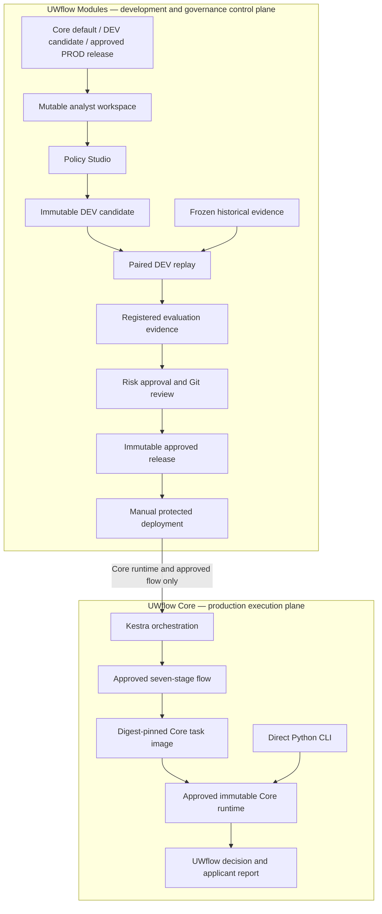

# UWflow v2 architecture

**Platform release:** `v2.0.0`  
**Core task image:** `ai/uwflow-core-runtime:2.0.0`  
**Optional module task image:** `ai/uwflow-runtime:2.0.0`

## Product boundary

UWflow is one integrated system with two product layers:

- **Core** is the original, independently runnable seven-stage UWflow system: Kestra Docker hosting and orchestration, the Python runtime, baseline policies, the full underwriting decision path and basic applicant reporting. It can run through Kestra or directly through the Python CLI.
- **Modules** are everything added on top of that original Core to manage its development and operation as a full underwriting platform: Policy Studio, DEV candidates, historical storage, champion–challenger evaluation, comparative reporting and controlled production promotion.

Core is not a generic workflow shell and it does not depend on the modules to make an underwriting decision. Modules extend and govern Core; they do not replace or duplicate its underwriting engine.

See [Core and Modules](core-and-modules.md) for the ownership map and execution contracts. See [UWflow lifecycle and storage model](lifecycle-and-storage.md) for the authoritative workspace-to-deployment object model.

## Execution architecture

Kestra owns orchestration, task order, dependencies, fan-out, isolation and execution history. Python Core executes the underwriting logic. AIDflow supplies profile scoring; UWflow owns affordability, pricing and the final decision. Core Stage 7 creates the basic report for one applicant. The Reporting module creates comparative portfolio evidence for champion–challenger review.

Historical evaluation uses immutable point-in-time evidence and exact baseline/candidate bundles. It does not call live providers to fill historical gaps. An analyst can create an independent workspace from the Core defaults, any existing DEV candidate or any approved release; a fork records its source manifest hash and pinned runtime/flow-template identity. Production promotion remains outside Studio and follows the protected Git/release path. Only the approved Core runtime and production flow execute in PROD; Modules remain the development/governance control plane.

## Source tree ownership

| Path | Owner | Responsibility |
|---|---|---|
| `core/docker/` | Core | Core Python task image and Kestra bootstrap. |
| `core/docker-run.sh`, `core/scripts/` | Core | Local Kestra launcher and Core-only local credential setup. |
| `core/kestra/` | Core | Seven-stage DEV baseline flow, production execution-flow contract and immutable runtime releases. |
| `core/python/runtime/` | Core | Canonical nine-file underwriting runtime shared by Kestra and the local CLI. |
| `core/python/` | Core | Direct seven-stage Python command. |
| `core/underwriting/policies/` | Core | Canonical baseline policy definitions and schemas. |
| `core/underwriting/examples/` | Core | Synthetic application examples and applicant report examples. |
| `core/underwriting/tools/` | Core | Immutable Core runtime bundle builder and verifier. |
| `tools/demo/` | Core CLI helpers | Core-owned entry points for standalone demo execution and applicant report generation. |
| `modules/policy-studio/` | Policy Studio | React/Vite frontend, FastAPI authoring API and Compose definition. |
| `modules/lifecycle/` | Lifecycle | Content-addressed candidate construction, bundles and manual DEV flows. |
| `modules/history/` | History | Dataset contracts, connectors, storage and history-tools bundles. |
| `modules/evaluation/` | Evaluation | Paired replay flow source and builder. |
| `modules/reporting/` | Reporting | Champion–challenger portfolio analysis and reports. |
| `modules/production/` | Production | Approved-release assembly, hash verification, provenance and controlled promotion tooling. |
| `var/workspaces/strategies/` | Analyst workspace data | Mutable per-strategy policy specs and workspace lineage; ignored by Git by default. |
| `var/artifacts/candidates/` | Immutable DEV artifacts | Candidate runtime, policy snapshot, source/flow provenance and manual DEV flow. |
| `var/artifacts/evaluations/` | Evaluation evidence | Registered replay outputs and checksummed evidence; local evidence storage is ignored by Git. |
| `var/releases/approved/` | Approved production artifacts | Immutable Core-only runtime and production-flow packages accepted by deployment automation. |
| `var/deployments/production/` | Deployment records | Current pointer and historical deployment provenance. |
| `modules/platform-runtime/` | Platform Runtime | Optional dependency image layer on top of the Core task image. |
| `tools/` | Operator interface | Operator procedures, Core-maintainer utilities and shared Kestra integration helpers. |

The History module source package lives at `modules/history/python/uwflow_history/`; its uploaded Namespace Files snapshot preserves the `scripts/uwflow_history/` directory prefix. The Core runtime retains the nine flat top-level modules required by the existing Kestra task contract. These are separate packages and release artifacts.

The Core namespace-files path remains flat at execution time (`runtime/releases/<version>/`). New candidate bundles are stored under `var/artifacts/candidates/`, replay flows under `var/artifacts/replay-flows/`, and History helper bundles under `var/artifacts/tool-bundles/`. Approved production packages live under `var/releases/approved/`; only this boundary is accepted by the production deployment workflow.

## Task images

- `ai/uwflow-core-runtime:<version>` is enough for the seven Core underwriting tasks, including the basic applicant PDF report.
- `ai/uwflow-runtime:<version>` extends the matching Core image with History/Evaluation dependencies such as SQLAlchemy, PostgreSQL and PyArrow.

The Core runtime bundle is versioned and uploaded to Kestra Namespace Files. It is not baked into the task image. History replay flows use the optional platform image because they execute History and Evaluation tooling; Core baseline and production underwriting flows use only the Core image.

## Versioning and governance

The semantic platform version identifies the complete UWflow platform (`v2.0.0`); the archive suffix identifies a packaging iteration. The Core runtime release, DEV candidate ID and approved production release ID are separate identities. A candidate does not reserve a production release ID. Only the Production assembler assigns the explicitly supplied release ID after evaluation and approval. The checked-in Core runtime snapshot is the current independently runnable baseline. Approved runtime releases are assembled separately under `var/releases/approved/`.

A DEV candidate is not a production release. The Production module verifies candidate, evaluation and approval identities, assembles an immutable approved release, and pins the Core image by digest. The approved package is merged through reviewed Git changes to protected `main`; a manual GitHub Actions dispatch with the exact release ID and the protected `uwflow-production` Environment deploys only that package. Platform semantic tags do not trigger production deployment.
