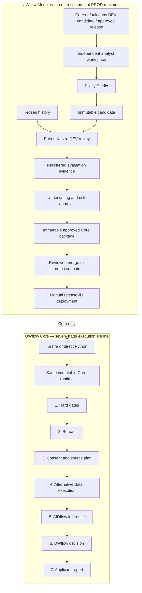

# Architecture: Core and Modules

UWflow v2 is divided into two product layers with a deliberate ownership boundary.

**Core is the original, independently runnable seven-stage underwriting system. Modules are the later platform capabilities that develop, test, govern and propagate versions of Core.**

The v2 package must preserve this separation both physically in the repository and operationally at runtime.

## Core — a complete underwriting engine

Core is not a generic workflow runner waiting for an application to be supplied. It already contains the UWflow application and can run the full seven-stage journey without the optional modules.

Core owns:

1. **Kestra hosting and orchestration contract:** local Kestra Docker launcher, Docker Task Runner integration and the baseline seven-stage flow.
2. **Python execution:** pinned task image, bootstrap, immutable runtime verification and direct Python CLI.
3. **Underwriting domain logic:** hard gates, bureau assessment, consent/source planning, alternative-data execution, AIDflow inference, final UWflow decision, affordability and pricing.
4. **Baseline policy configuration:** Stage 1 and Stage 3 canonical baseline definitions plus protected code-managed logic for the other stages.
5. **Basic applicant reporting:** the Stage 7 JSON, HTML and PDF decision outputs.

The same nine-file runtime source is used by the local Python runner and the Kestra flow. Kestra orchestrates separate tasks; the Python CLI invokes the same domain functions in process and adds the same Stage 7 applicant report generation.

Core entry points:

```bash
python -m core.python.cli
```

```bash
bash core/docker-run.sh
```

For Kestra execution, build the Core image, publish the immutable Core runtime bundle and deploy the manual DEV baseline flow as described in [Core on Kestra](../../core/kestra/README.md).

## Modules — the full underwriting lifecycle

Modules were developed after the original Core and provide the capabilities needed to operate UWflow as a governed underwriting platform:

| Module | Adds to Core |
|---|---|
| Policy Studio | Frontend, API, visual authoring, policy validation, generated-code preview and controlled save. |
| Lifecycle | Content-addressed DEV candidates, candidate identity, baseline/candidate flow generation and safe publication tooling. |
| History | Persistent historical data, PostgreSQL/Parquet connectors, immutable dataset snapshots and source/outcome evidence. |
| Evaluation | Paired champion–challenger replay orchestration against exactly the same historical dataset. |
| Reporting | Comparative portfolio, score-decile, segment, coverage and decision-migration analysis. |
| Production | Git/CI release preparation, immutable runtime and OCI image pinning, provenance and protected PROD deployment. |
| Platform Runtime | Optional additional task-image dependencies needed by modules, layered on the Core image. |

The boundary is important: the basic report for one applicant is Core Stage 7; comparative portfolio and champion–challenger reports are Reporting module outputs. Analyst strategy edits live under `var/workspaces/strategies/`; immutable candidates live under `var/artifacts/candidates/`; registered evaluation evidence lives under `var/artifacts/evaluations/`; approved deployment packages live under `var/releases/approved/`. An analyst can start from Core defaults or fork any existing DEV candidate or approved release into a new workspace. Studio and Lifecycle never write into Core. The production deployment contains Core runtime files and the approved Core flow only; it does not deploy the platform Modules.

## How the integrated platform works



Core remains the execution and decision engine in every environment. Modules author, package, evaluate and govern changes to Core; they do not become a second underwriting engine.

## Repository ownership

| Repository path | Owner | Responsibility |
|---|---|---|
| `core/docker/` | Core | Python task image and bootstrap. |
| `core/kestra/` | Core | Kestra launcher, seven-stage flows and immutable runtime releases. |
| `core/python/runtime/` | Core | Canonical nine-file underwriting runtime used by both execution modes. |
| `core/python/` | Core | Direct Python execution and seven-stage CLI. |
| `core/underwriting/` | Core | Baseline policy specifications, schema, basic examples and runtime bundle tooling. |
| `modules/policy-studio/` | Policy Studio | Analyst frontend and authoring API. |
| `modules/lifecycle/` | Lifecycle | Workspace and candidate lifecycle implementation; generated candidate artifacts are outside module source. |
| `var/workspaces/strategies/` | Analysts / Studio | Mutable strategy workspaces with source lineage and pinned Core runtime identity. |
| `var/artifacts/candidates/` | Lifecycle | Immutable DEV runtime, policy and flow snapshots. |
| `var/releases/approved/` | Production release process | Immutable approved deployment packages; sole production deployment source. |
| `modules/history/` | History | Frozen historical data, connectors and history tooling. |
| `modules/evaluation/` | Evaluation | Paired replay flows. |
| `modules/reporting/` | Reporting | Comparative analysis and reports. |
| `modules/production/` | Production | Release pinning and deployment implementation. |
| `modules/platform-runtime/` | Platform Runtime | Optional dependencies on top of the Core task image. |

## Image boundary

`ai/uwflow-core-runtime:<version>` is sufficient for the seven-stage Kestra Core flow. It includes the Kestra Python adapter and ReportLab, which is needed for the basic applicant PDF report.

`ai/uwflow-runtime:<version>` extends the Core image with optional module dependencies such as SQLAlchemy, psycopg and PyArrow. History/Evaluation tasks can use this extended image where required. Core baseline and production execution flows use the Core image, not the optional platform image.

Neither image contains the immutable underwriting runtime source. Kestra flows pin and load that runtime from Namespace Files after verifying its manifest and file hashes.

## Non-negotiable contracts

- Core runs independently; it does not require Policy Studio, History, Evaluation, Reporting or Production to decide one application.
- Modules must call, package or govern Core rather than duplicate the underwriting decision logic.
- Candidate bundles and candidate flows are Lifecycle artifacts. Versioned baseline runtime releases and the seven-stage execution contract remain Core-owned.
- Historical replay uses frozen records and never calls live providers to fill missing historical evidence.
- Core owns the applicant-level Stage 7 report. Reporting owns comparative cohort and portfolio analysis.
- Only the Production module and protected GitHub release workflow promote an approved version to PROD. Studio and Lifecycle do not deploy production.
