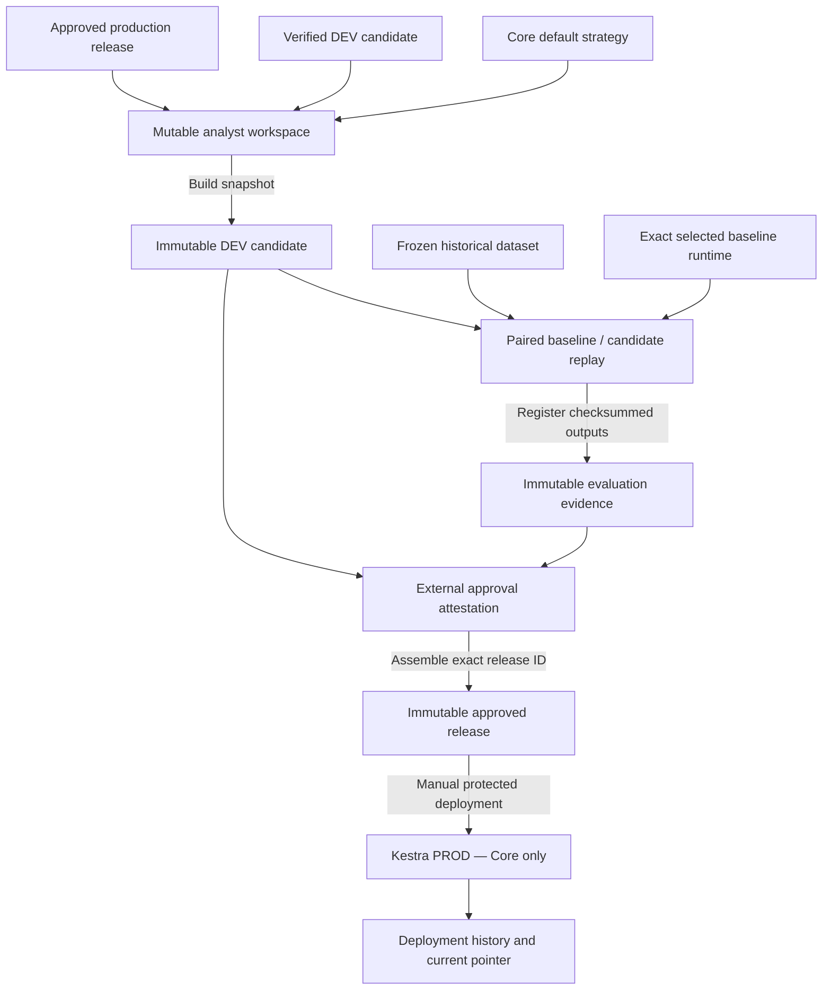

# UWflow lifecycle and storage model

This document is the authoritative reference for how UWflow moves an underwriting strategy from editable analyst work to an evaluated, approved and deployed production release. It also defines where each object lives, who owns it and when it may change.

The lifecycle is one connected capability. Policy Studio, Lifecycle, History, Evaluation, Reporting and Production are separate Modules, but they operate on the same governed objects and hand them from one controlled stage to the next.

## Lifecycle at a glance



The operating principle is:

**Core executes underwriting. Modules develop and govern strategy. History supplies evidence. Git and the approval process govern promotion.**

Core remains independently runnable through its Python CLI or its seven-stage Kestra flow. The Modules are not required to run an ordinary Core underwriting decision and are not deployed into the live production execution path.

## Stable repository root and operational state

The repository root is intentionally stable. It contains source code, configuration, documentation, tests and operator tooling. Studio, Core runs, DEV dry-runs, replay/evaluation tasks and production lifecycle operations must not create new top-level directories beside those source areas.

The stable top-level directory layout is:

```text
repository-root/
├── .github/
├── core/
├── docs/
├── modules/
├── tests/
├── tools/
└── var/       all local runtime and lifecycle-managed data
```

All repository-local mutable or lifecycle-managed data is rooted at `var/`:

```text
var/
├── venv/                          managed local Python environment
├── cache/                         local tool caches
├── build/ and dist/               generated Python package build output
├── workspaces/strategies/        mutable analyst workspaces
├── artifacts/                    candidates, replay flows, History bundles, baselines and evaluations
├── releases/approved/            approved immutable production packages
├── deployments/production/       deployment pointer and provenance history
├── reports/                      generated applicant and comparison reports
├── data/history/                 local history datasets and file-backed storage
└── operator-state/               local selections and workflow recovery markers
```

The `var/` root is included as a stable placeholder with explanatory README files. Its operational subdirectories are created lazily by the relevant operation. In a clean package, it contains no generated runtime state. Approved release packages are the exception to the usual generated-state Git rule: they are intentionally committed through protected review so the production workflow can deploy the exact approved package. Other generated operational state is ignored by Git and excluded from Docker build contexts and source distributions. Kestra Namespace Files paths such as `runtime/releases/<version>/` are remote paths and are not part of this repository tree.

## Objects and their storage

| Object | Canonical location | Owner | Change rule |
|---|---|---|---|
| Core source and default policy | `core/` | Core | Changed only through reviewed source changes. |
| Core runtime baseline | `core/kestra/namespace-files/runtime/releases/<runtime-version>/` | Core | Immutable, versioned runtime snapshot. |
| Managed Python environment | `var/venv/` | Developer / operator setup | Created locally on first run; ignored by Git and excluded from packages and Docker contexts. |
| Tool caches | `var/cache/` | Developer / operator tooling | Disposable local caches; never source-controlled. |
| Python package metadata and build output | `var/*.egg-info/`, `var/build/` and `var/dist/` | Packaging tools | Generated locally; the existing `var/` root makes editable installs work from a clean extraction; generated metadata is ignored by Git and absent from clean UWflow ZIP releases. |
| Analyst workspace | `var/workspaces/strategies/<workspace-id>/` | Analyst / Policy Studio | Mutable. Holds editable policy specifications and workspace metadata. |
| DEV candidate | `var/artifacts/candidates/<candidate-id>/` | Lifecycle | Immutable snapshot. Never edited in place. |
| History tooling bundle | `var/artifacts/tool-bundles/history/<bundle-id>/` | History | Generated from Module source; immutable and content-addressed. |
| Replay flow | `var/artifacts/replay-flows/<flow-id>.yaml` | Evaluation | Generated for exact candidate, baseline and History bundle identities. |
| Generated baseline flow | `var/artifacts/baselines/<flow-id>.yaml` | Lifecycle | Generated for the exact Core/approved runtime and flow template. |
| Evaluation evidence | `var/artifacts/evaluations/<evaluation-id>/` | Evaluation | Registered once with a manifest and checksums; immutable. |
| Approved production release | `var/releases/approved/<release-id>/` | Production | Immutable deployable package. Cannot be overwritten. |
| Production deployment state | `var/deployments/production/current.json` and `var/deployments/production/history/` | Production deployment workflow | Append deployment records and update the current pointer after deployment succeeds. |
| Core and comparison reports | `var/reports/` | Core / Evaluation / Reporting | Generated output; not a source or release input unless explicitly registered as evaluation evidence. |
| Local history data | `var/data/history/` | History | Local dataset/file-backed storage; may be large or sensitive and is never part of a source package. |
| Operator selections | `var/operator-state/` | Operator scripts | Local workflow selections and recovery markers; disposable/re-creatable and never source-controlled. |

The repository contains source code and the Core baseline needed to get started. Workspaces, candidates, replay flows, History bundles, evaluations, approved releases and deployment records are created by the lifecycle as the corresponding operations are performed. They are not pre-populated with development or test runs in a clean source package.

## 1. Create or fork a workspace

A workspace is an analyst's mutable working copy of the supported strategy policies. It contains:

```text
var/workspaces/strategies/<workspace-id>/
├── workspace.json
└── policy-specs/
    ├── stage1_hard_gates.json
    └── stage3_source_plan.json
```

`workspace.json` records the workspace ID, display name, timestamps, source type and source ID, source manifest hash when applicable, parent workspace, pinned Core runtime source and pinned production-flow template.

A workspace can start from:

- **Core defaults** — a clean starting strategy based on the canonical policy specifications in `core/`.
- **A verified DEV candidate** — the workspace copies the candidate's editable policies and records the exact candidate identity and manifest hash.
- **An approved production release** — the workspace copies the approved release's editable policies and pins its runtime and production-flow package.

Forking copies the supported policy specifications into a new workspace. It does not copy, edit or mutate the source runtime, candidate or approved release. Two analysts can therefore work independently from the same source.

Policy Studio is the supported editor for the current editable stages. Saving changes updates only the selected workspace. It does not build a candidate, run a replay, approve a release or deploy production.

## 2. Build an immutable DEV candidate

Lifecycle validates the selected workspace, compiles its policy specifications and packages the strategy with the exact Core runtime and flow-template inputs pinned by that workspace.

A candidate is written to:

```text
var/artifacts/candidates/<candidate-id>/
├── release-manifest.json
├── candidate-artifact-manifest.json
├── candidate-flow.yaml
├── production-flow-template.yaml
├── policy-specs/
└── <nine Core runtime modules>
```

The runtime manifest identifies the candidate's Core runtime files and policy hashes. The artifact manifest checksums the complete candidate payload, including its flow and template. Candidate provenance records the workspace ancestry, baseline identity, Core source reference/status and relevant content hashes.

The candidate ID is content-addressed. Rebuilding identical inputs produces the same identity; changing a policy, runtime, baseline or flow input produces a different candidate. Existing candidate content is never overwritten.

Candidate provenance records whether the Core source tree was `clean`, `dirty` or `unverified` when the candidate was built. A candidate can be useful for DEV exploration when its source tree is dirty or its Git provenance is unavailable, but **it is not eligible for production release assembly**. The Production assembler requires `core_source_tree_status: clean`; rebuild from a reviewed Git commit with a clean `core/` source tree before seeking production approval.

Building a candidate is local packaging only. It does not call Kestra, publish Namespace Files, run Evaluation, create approval evidence or assign an approved release ID.

## 3. Select historical evidence and run paired replay

History owns the historical data contract, storage connectors, dataset validation and immutable evidence selection. A replay must use one explicitly selected, validated dataset. Historical observations are point-in-time: the replay must not fill missing past observations with current provider data.

Evaluation builds a manual DEV replay flow for:

- the exact baseline runtime;
- the exact immutable candidate;
- the exact History tooling bundle;
- the selected dataset and replay parameters.

The baseline and candidate branches run against the same frozen dataset. Kestra validates the dataset first, executes the two branches in parallel, and compares their outputs only after both complete successfully.

Generated replay support files are build outputs, not source code:

- `var/artifacts/tool-bundles/history/<bundle-id>/` contains the exact History Python package and replay/reporting tools needed by the tasks.
- `var/artifacts/replay-flows/<flow-id>.yaml` contains the manual DEV flow pinned to the selected bundle and runtime hashes.
- `var/artifacts/baselines/<flow-id>.yaml` contains a generated DEV flow for the selected baseline runtime.

These paths are created by the respective build tools. A clean repository does not need to ship a pre-generated bundle or replay flow; the operator workflow creates them from current Module source.

## 4. Register evaluation evidence

A successful replay produces comparison output such as `comparison.json`, case-level results, decision migrations, stage comparisons, score deciles, segment impact and source coverage. The exact outputs depend on the replay/reporting configuration.

Register the completed output with `modules/evaluation/tools/register_evaluation.py`. Registration verifies that the candidate is a complete current-format artifact and that the selected baseline matches the candidate's recorded parent. It then copies the supplied evidence into:

```text
var/artifacts/evaluations/<evaluation-id>/
├── evaluation-manifest.json
└── <registered comparison evidence>
```

The evaluation manifest binds the evidence to the exact candidate ID and candidate manifest hash, baseline release, dataset ID and checksums of the registered files. An evaluation ID can be registered only once. Editing the registered evidence invalidates its checksum chain and prevents its use in an approved release.

The approved release stores an `evaluation-reference.json` with the evaluation manifest digest and evidence file checksum map; **it does not copy the full replay-evidence payload into the release package**. Before treating an evaluation as a formal governance record, export the registered evidence and its manifest to the organisation's retention-controlled evidence store and retain the authoritative approval record there as well. This repository does not implement WORM retention, legal hold, signed approval or an institutional evidence vault. The checksummed local registration is a verifiable hand-off/reference, not a substitute for that external retention system.

Evaluation is evidence, not approval. A favorable comparison does not automatically make a candidate deployable.

## 5. Approve and assemble a production release

Approval is an explicit governance event outside the replay tool. The organisation's authorised risk/model governance process must approve the exact candidate and evaluation. The supplied approval attestation identifies:

- `status: approved`;
- exact `candidate_id` and `candidate_manifest_sha256`;
- exact `evaluation_id`;
- `approved_by` and `approved_at`.

`approved_by` is an attestation value supplied by that approval process; it is not, by itself, authenticated identity, a digital signature or UWflow RBAC.

Production assembles a release only when the candidate, source provenance, all runtime/policy/flow checksums, evaluation manifest and evidence, approval attestation and digest-pinned Core task image verify. The release ID is an explicit assembler input; it is not derived from the candidate ID or platform version.

The resulting package is written once to:

```text
var/releases/approved/<release-id>/
├── release-manifest.json
├── runtime/
├── production-flow.yaml
├── policy-specs/
├── candidate-manifest.json
├── candidate-artifact-manifest.json
├── evaluation-reference.json
└── approval-reference.json
```

The release manifest binds the approved runtime, production flow, candidate, evaluation, approval and immutable image identities. The directory cannot be overwritten.

The approved release directory is the deployable source artifact. Add the complete `var/releases/approved/<release-id>/` directory and required provenance references to a reviewed pull request, then merge it to protected `main`. Candidate and evaluation working artifacts remain generated operational state and are not committed as source-tree content. Retain the authoritative business approval record and full replay evidence in the organisation's external retention-controlled system; the release package stores checksummed references, not a second copy of the full evidence payload.

Assembly is not deployment and does not contact Kestra.

## 6. Deploy and roll back

A production package must first be included in a reviewed pull request and merged to protected Git branch `main`. Production deployment is then a manual GitHub Actions `workflow_dispatch` from `main`, naming the exact approved release ID and using the protected `uwflow-production` environment.

The deployment workflow re-verifies the approved package and deploys only:

- `var/releases/approved/<release-id>/runtime/` to Kestra Namespace Files under `runtime/releases/<release-id>/`;
- `var/releases/approved/<release-id>/production-flow.yaml` to `com.ai.credit.production`.

Policy Studio, Lifecycle, History, Evaluation, Reporting and the optional platform task image are not deployed into the Core production execution path.

After a successful deployment, the workflow writes a deployment record under `var/deployments/production/history/` and updates `var/deployments/production/current.json`. GitHub Actions also retains the run artifact. The local checkout is not automatically updated by a remote workflow run; synchronize the deployment record when local tooling needs to display the currently deployed release.

Rollback is a new deployment of a previously approved immutable release. It is not an edit to the current release and does not create a new candidate.

## Identity model

Do not treat these identifiers as interchangeable:

| Identity | Example | What it identifies |
|---|---|---|
| Platform version | `2.0.0` | The complete UWflow product package. |
| Core runtime version | `2.0.0` | The independently runnable Core execution bundle. |
| Workspace ID | `strategy-<id>` | One mutable analyst strategy workspace. |
| Candidate ID | `dev-<16 hex>` | One immutable DEV strategy/runtime snapshot. |
| History bundle ID | `ht-<16 hex>` | One immutable build of the History task payload. |
| Evaluation ID | `eval-<name>` | One registered comparison-evidence package. |
| Approved release ID | `2.0.1` | One immutable, approved production deployment package. |
| Deployment run | GitHub run ID | One attempt to deploy an approved release. |

The platform version, Core runtime version and approved release ID may happen to have similar values, but they represent different objects and follow different lifecycle rules.

## Ownership and mutability rules

| Location | May change by | Must not be changed by |
|---|---|---|
| `core/` | Reviewed Core source/runtime release process | Policy Studio, candidate builders, History, Evaluation or Production side effects |
| `var/workspaces/strategies/` | Analyst / Policy Studio | Candidate/evaluation/release builders modifying the source workspace |
| `var/artifacts/candidates/` | Lifecycle creates a new candidate | Any in-place edit after creation |
| `var/artifacts/tool-bundles/`, `var/artifacts/replay-flows/`, `var/artifacts/baselines/` | Their deterministic build tools create new outputs | Manual edits or overwrite of an existing content-addressed artifact |
| `var/artifacts/evaluations/` | Evaluation registration creates a new record | Re-running registration over or editing registered evidence |
| `var/releases/approved/` | Production assembler creates a new approved release | Manual edits, candidate builder or deployment workflow |
| `var/deployments/production/` | Successful deployment workflow | Workspace, candidate, evaluation or release assembly steps |

The main safety boundary is simple: **mutable strategy work ends at candidate creation; evidence and approvals bind that exact candidate; production executes only an approved release package.**
