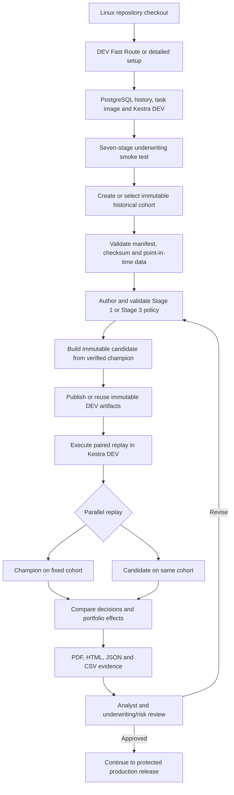

# UWflow — End-to-end DEV workflow

This guide walks through the complete local development workflow: the seven-stage underwriting runtime, the independent PostgreSQL history store, immutable synthetic portfolio generation, paired champion/challenger replay and Policy Studio candidate authoring. The replay uses a frozen baseline runtime, an immutable candidate runtime and a manual DEV Kestra flow.

For a one-command Linux setup that builds and starts the complete Policy Studio and proves a 100-case Kestra paired replay, use the [DEV Fast Route](dev-fast-route.md). This detailed guide remains the source of truth for the reasoning and recovery behind each step.

The workflow verifies the local development path and produces reproducible evidence for policy review. It does not promote a candidate to PROD.

## Development workflow at a glance




## What this walkthrough proves

By the end, you should have:

1. A working local Kestra instance and the normal seven-stage DEV smoke test.
2. A separate PostgreSQL history database, independent of Kestra's own metadata store.
3. An immutable 5,000-case synthetic dataset that passes a checksum read-back validation.
4. A local 100-case baseline/no-op-candidate comparison.
5. A manual Kestra flow that validates the same dataset, replays baseline and candidate in parallel, and creates comparison artifacts.
6. A local Policy Studio edit saved as a new immutable DEV candidate, followed by a replay against the exact same dataset.

Synthetic outcomes are illustrative software fixtures only. They are not observed loan performance, calibrated PD estimates or evidence of improved credit risk.

## Before you start: terminal and command rules

Extract the ZIP and open a Bash terminal **directly in the extracted `uwflow` folder** — the directory containing `pyproject.toml`, `docker-run.sh` and `tools/`. Use “Open in Terminal” from your file manager. There is no placeholder `cd` command or helper to source.

All end-to-end shell logic is kept under `tools/guides/workflow/`. Each guide step below is one command that launches its script through `bash`. You do not need to run `chmod` first. Every script checks that the current directory is the UWflow repository root. Every script that needs Python activates `var/venv` inside its own process, so **a new Terminal B/C/D does not inherit or need Terminal A's virtual-environment activation**.

Keep the terminals organised as follows:

| Terminal | Purpose | Long-running process |
|---|---|---|
| Setup terminal | Run setup, database bootstrap, local replay and publishing steps | No; run each script and return to the prompt |
| Terminal A | Kestra | Yes; keep Step 8 running |
| Terminal C | Complete Dockerized Policy Studio (API + React frontend) | Yes; keep Step 18 running |

When opening any new terminal, open it in the same extracted `uwflow` folder before copying the corresponding one-line command.

## Part A — Prepare the local environment

### 1. Check prerequisites

```bash
bash tools/guides/workflow/00-preflight.sh
```

This validates the repository location, Python version, Bash, Docker CLI, Compose plugin and Docker daemon. Do not continue if Docker is not running.

### 2. Install Python dependencies and run the baseline checks

```bash
bash tools/guides/workflow/01-python-environment.sh
```

This creates `var/venv`, reuses it only when its interpreter and activation script are valid, or repairs an incomplete environment. It installs the dev, Studio, PostgreSQL and Parquet extras, and runs pytest plus compiler and immutable-bundle checks. The History tooling bundle is generated from tracked Module sources on first setup (or reused after exact content verification); it is intentionally not shipped as pre-generated state in the clean package. It also installs `httpx2` for Starlette's TestClient integration to avoid the deprecated plain-`httpx` fallback.

### 3. Build the Policy Studio Docker images

```bash
bash tools/guides/workflow/02-build-studio-images.sh
```

This builds the Python API and Node 26 frontend images. The launcher returns only after both image builds finish. Step 18 starts the services from these images through Docker Compose. Node.js, npm and frontend dependencies remain inside the frontend container.

### 4. Create local Kestra credentials

```bash
bash tools/guides/workflow/03-create-local-credentials.sh
```

Creates `.env` only when absent. It does not replace an existing password. Keep this file private.

### 5. Create the paired historical-data credentials

```bash
bash tools/guides/workflow/04-create-history-credentials.sh
```

Creates `.env.history` and `.env.history.kestra` together on a fresh setup. If both already exist, the script reuses and validates them. If only one exists, restore the matching file from a protected backup before continuing.

When both files are missing but the named PostgreSQL container or `uwflow_history_pgdata` volume already exists, Step 04 offers a controlled credential recovery. After approval, it creates new owner, reader and writer passwords without replacing the database volume. Step 06 synchronizes the owner login through PostgreSQL's local administrative socket; Step 07 reloads Kestra with the regenerated read-only secret; Step 10 synchronizes the reader and writer roles during the normal database initialization. The recovery changes database login credentials only. It does not delete or recreate the database, schemas, historical records or persistent volume.

The credential generator writes repository path values as quoted assignments, so a checkout path containing spaces remains one valid value when `.env.history` is sourced. The helper checks the three history root paths before allowing the workflow to continue.

### 6. Build the Python task image

```bash
bash tools/guides/workflow/05-build-task-image.sh
```

Builds the Core task image `ai/uwflow-core-runtime:2.0.0` and the optional platform task image `ai/uwflow-runtime:2.0.0` if they are not already present. Core runs the seven underwriting stages; History/Evaluation tasks use the platform image and its additional database/Parquet dependencies. Kestra still launches an isolated container for each Python task.

### 7. Start the separate PostgreSQL history database

```bash
bash tools/guides/workflow/06-start-history-database.sh
```

The script starts `uwflow-history-db` when absent, or reuses/starts the existing named container when present. It verifies the expected persistent volume and polls the PostgreSQL health check. Crucially, `pg_isready` health alone does not prove that `.env.history` can authenticate: the script also opens a real TCP connection using the configured admin DSN. If Step 04 recovered missing credentials, the previously approved owner-password change is applied through the container’s local PostgreSQL administrative socket. Otherwise, an unexpected password mismatch is presented for explicit approval. This changes no schemas, application rows or Docker volume. PostgreSQL listens on `127.0.0.1:55432` on the host and `uwflow-history-db:5432` on the shared Docker network. Data persists in Docker volume `uwflow_history_pgdata`; the workflow never removes that volume.

Step 10 repeats the admin-connection preflight immediately before schema initialization, so it remains safe when you open a new terminal or run Step 10 independently. A healthy container is not treated as proof of valid credentials. During approved credential recovery, Step 7 verifies the existing Kestra container mounts before stopping it. The local Kestra launcher uses Docker `--rm`, so Docker may remove the stopped container automatically; the reload helper waits for that removal and treats an already-removed container as a successful shutdown. It starts a fresh Kestra container with the regenerated secret file while preserving `kestra_data` and `kestra_db`.

### 8. Start Kestra — Terminal A

Open Terminal A directly in the `uwflow` folder and run:

```bash
bash tools/guides/workflow/07-start-kestra.sh
```

Keep it open. Kestra runs in the foreground on [http://localhost:8080](http://localhost:8080). The launcher loads the optional `.env.history.kestra` file when it exists; this is how the read-only PostgreSQL DSN becomes available to Kestra task containers.

### 9. Install the Kestra CLI and deploy the v2.0.0 DEV baseline

In the setup terminal:

```bash
bash tools/guides/workflow/08-install-kestra-cli.sh
```

Then:

```bash
bash tools/guides/workflow/09-deploy-dev-baseline.sh
```

The deploy script loads local Kestra credentials from `.env` and checks the local immutable baseline bundle and flow. If the remote directory does not exist yet, the script identifies that normal first-publication state, offers to upload, and verifies the destination after upload. If the path already exists, it displays the listing and allows reuse only after you confirm the expected files and `release-manifest.json` are exact. It never uploads over an existing immutable path. Unexpected API, authentication or permission errors stop the workflow.

### 10. Execute the normal underwriting smoke test

In the Kestra UI, open namespace `com.ai.credit.dev`, flow `uwflow_dev_baseline_v2_0_0`, and choose **Execute** with the default John Jones synthetic inputs. Wait for all seven stages, then inspect `stage7_render_report` and download its HTML, PDF and JSON artifacts.

The deterministic smoke fixture is expected to return `APPROVED`, AIDflow score `837/900`, approved amount `€8,194.20` and illustrative APR `8.9%`. These are code-path expectations, not a credit-risk calibration result.

## Part B — Initialise PostgreSQL and validate the immutable dataset

### 11. Initialise schemas and database roles (first-time setup, and after a schema upgrade)

Open a **new terminal** directly in the `uwflow` folder. Run:

```bash
bash tools/guides/workflow/10-initialize-history-database.sh
```

This script activates `var/venv` itself, loads `.env.history`, checks that PostgreSQL is healthy and runs `tools.history.database.initialize --allow-write` with the dedicated admin DSN. You do not need to run `source var/venv/bin/activate`, `.env.history` or any other setup command manually in Terminal B.

The bootstrap creates/updates the four logical schemas and least-privilege roles:

| Schema | Contents |
|---|---|
| `history` | Application snapshots, recorded decisions, segments and canonical historical case payloads |
| `sources` | Bureau and alternative-data snapshots |
| `outcomes` | Separately timestamped outcome snapshots |
| `simulation` | Immutable dataset manifests |

It configures an owner/admin identity for bootstrap, `uwflow_history_reader` with SELECT-only access, and `uwflow_history_writer` with SELECT/INSERT only. The writer cannot UPDATE or DELETE immutable dataset rows.

For checksum reproducibility, the PostgreSQL adapter stores the exact canonical JSON representation of each case in `history.canonical_case_payloads`, alongside the query-friendly JSONB projections. Schema initialization creates the table when it is absent and applies the reader/writer grants. Re-running this step is safe: it applies schema changes without deleting or rewriting dataset rows.

### 12. Create or reuse the canonical 5,000-case synthetic dataset

From a terminal in the repository root:

```bash
bash tools/guides/workflow/11-select-or-create-dataset.sh
```

The script lists the existing dataset manifests, then asks whether you want to reuse an existing dataset or create/reuse today's standard one. For the standard FSTPD30 portfolio, press Enter to create or reuse today's canonical dataset. You can also enter an existing dataset ID after checking that its manifest declares the FSTPD30 target. The canonical ID begins `synthetic-eur-v4-fstpd30-`; it identifies the FSTPD30 generator contract, while the canonical payload format is recorded separately in the manifest. If today's dataset already exists, the script validates and reuses it rather than trying to create a duplicate.

The standard generated portfolio uses seed `17`, 5,000 cases and a 36-month historical window. Its target is `FSTPD30`: 1 if any of the first three scheduled instalments reaches 30+ days past due, 0 otherwise, and null until the four-month observation window matures. The generator creates outcomes independently of policy decisions so the exact same applicants and outcomes can be replayed against the champion and challenger. **The script immediately runs the independent read-back validator after generation. It records the selected dataset ID only if validation passes.** A mismatch is a hard stop; no replay step should follow.

#### Selecting a compatible FSTPD30 dataset

Datasets created for earlier demonstration targets are not interchangeable with the FSTPD30 cohort. Select a dataset whose ID begins `synthetic-eur-v4-fstpd30-` and whose manifest records the expected generator, target and canonical payload format. Dataset IDs are immutable; create a new ID when the generator contract or cohort definition changes.

If the new FSTPD30 dataset fails validation, stop and preserve the error output. Do not proceed to local replay or Kestra replay; the historical store has not passed its integrity gate.

## Part C — Verify paired baseline/candidate replay locally

### 13. Run the included no-op candidate against the same 100 cases

```bash
bash tools/guides/workflow/12-run-local-noop-replay.sh
```

The script verifies that the included content-addressed no-op candidate is based on `2.0.0` and has the same runtime module hashes as the baseline. It then runs 100 cases through both runtimes and compares the outputs. The comparison is written under `var/reports/history/local-<candidate-id>/comparison/`.

Because this candidate is intended to be a no-op, the initial comparison should show zero differences in decision, score and approved amount. Any unexpected difference is a stop-and-investigate condition.

## Part D — Run the same replay through Kestra

### 14. Build the immutable history-tools bundle and candidate-specific replay flow

```bash
bash tools/guides/workflow/13-build-history-replay-flow.sh
```

The script builds or verifies the content-addressed history-tools bundle, generates a paired replay flow for the selected candidate and baseline, and records the exact bundle and flow IDs in `var/operator-state/`. The generated flow pins the selected bundle identity. The publisher checks that the local manifest, workflow state and generated flow agree before publication.

### 15. Publish/reuse the runtime and history-tools bundles, then deploy the replay flow

```bash
bash tools/guides/workflow/14-publish-history-replay-flow.sh
```

Before it contacts Namespace Files, the script runs `kestractl flows validate` against the configured Kestra server. This asks the actual server to validate the generated flow against its installed task/plugin schemas. If validation fails, the script stops immediately: it does not list Namespace Files, upload anything or attempt deployment.

Only after the server accepts the flow does the script inspect the three immutable bundle paths. A path that already exists is listed for review; reuse it only after confirming every manifest-listed file is present. A path that is genuinely absent is offered for first publication, then listed again to verify the upload. New uploads are staged from the local release manifest and SHA-256 checked before transfer, so local `__pycache__`, `.pyc` and other unmanifested files are excluded. Authentication, permission, timeout and other unexpected API errors remain hard stops. The script deploys the manual-only replay flow only after validation and all three bundle checks succeed.

### 16. Execute a 100-case smoke replay in Kestra

In Kestra, open namespace `com.ai.credit.dev` and the newly deployed `uwflow_dev_history_replay_<hash>` flow. Use:

| Input | Value |
|---|---:|
| `dataset_id` | The validated ID printed by Step 12 |
| `batch_size` | `2000` |
| `offset` | `0` |
| `max_cases` | `100` |

The validation task must pass before the `replay_pair` Parallel task starts. Kestra then runs the baseline and candidate batches concurrently (maximum two branches); the comparison task starts only after both finish successfully. If either branch fails, the Parallel task fails and interrupts its still-running sibling. Review task completion and download the smoke outputs from `compare_replays`: `champion_challenger_report.pdf`, `champion_challenger_report.html` and the CSV/JSON artifacts described in the [Champion vs Challenger report guide](champion-challenger-impact-report.md). A 100-case run verifies the path and report renderer only; do not use it to judge risk performance because the sample is intentionally small.

### 17. Execute the full 5,000-case portfolio replay

Only after the 100-case replay succeeds, execute the same flow again with the same dataset ID, `batch_size=2000` and `offset=0`, but set `max_cases=0` to process the complete dataset. Do not regenerate the dataset or change the selected baseline during a controlled comparison.

The comparison task produces the analyst/CRO deliverables:

- `champion_challenger_report.pdf` — printable portfolio impact report.
- `champion_challenger_report.html` — self-contained interactive/browser report.
- `comparison.json` — complete machine-readable metrics and provenance.
- `stage_comparison.csv` — all possible outcomes for each underwriting stage, counts and population shares.
- `score_deciles.csv` — approval/offer and FSTPD30 by AIDflow score decile.
- `segment_impact.csv` — approval, offer and FSTPD30 by bureau and applicant segments.
- `source_coverage.csv` — success, failure, missing and not-attempted counts for all ten sources.
- `case_comparison.csv` and `decision_migrations.csv` — application-level changes and champion-to-challenger movement.

In the Kestra execution, open the successful `compare_replays` task and download its output files. Keep them with the dataset manifest, baseline/candidate manifest identities and exact history-tools bundle ID. See the [Champion vs Challenger report guide](champion-challenger-impact-report.md) for metric definitions and interpretation.

## Part E — Change a policy in Policy Studio and replay the candidate

### 18. Start the complete Policy Studio — Terminal C

Open Terminal C directly in the `uwflow` folder:

```bash
bash tools/guides/workflow/15-start-studio.sh
```

This starts the Python API and React/Vite frontend together through Docker Compose. The API
container receives the current repository as a read/write mount, so analyst workspaces
and generated artifacts persist in this checkout. Core source is not writable through
the Studio API. The frontend container receives only
`./frontend` as a read-only source mount at `/workspace/frontend` and keeps Node/npm dependencies and Vite's optimizer cache in the persistent external Docker volume `uwflow_studio_node_modules`, mounted at `/workspace/node_modules`. The Compose project name is fixed to `uwflow-studio`, so upgrades from differently named extraction folders reuse the same services and dependency volume. The API health check must pass before the frontend starts; the operator script then verifies the frontend health and API proxy catalogue. No Node.js, npm, NVM or
frontend packages are installed on the host.

Keep Terminal C open. Open [http://127.0.0.1:5173](http://127.0.0.1:5173) for the Studio;
the API documentation is at [http://127.0.0.1:9000/docs](http://127.0.0.1:9000/docs).
The Studio is a local authoring tool without multi-user authentication; do not expose it to
the LAN or public internet.

### 19. Make one controlled Stage 1 policy change

In the Studio, first choose the strategy workspace you want to develop:

- Continue the existing workspace to resume the same analyst work.
- Create a workspace to start from Core's default strategy.
- Fork a DEV candidate or approved release to begin from that exact immutable strategy/runtime lineage. The fork copies the editable policy specifications into a new workspace and records the source manifest hash; it does not duplicate or modify the source artifact.

Then make one controlled policy change:

1. Select **Stage 1 — Hard gates**.
2. Find `MINIMUM_INCOME`.
3. Change its threshold from `655.54` to `700.00`.
4. Update the description to state that verified gross monthly income must be at least EUR 700.
5. Keep one positive `valid_when` predicate per input; PASS is derived when true, and FAIL plus its reason code is derived otherwise.
6. Click **Validate**, inspect **Python preview**, then click **Save policy**.

A Studio save writes the selected workspace's canonical policy JSON and generated preview only under `var/workspaces/strategies/<workspace-id>/`. It does not modify `core/`, mutate an immutable candidate/release, upload Namespace Files or deploy a flow. Candidate provenance records the source commit and whether the `core/` subtree was clean; this is not itself proof of branch protection. An unverified ZIP extraction remains useful for DEV experiments but is not eligible for production promotion. Production deployment later requires the approved package to be merged to protected `main` and manually dispatched from that branch.

### 20. Verify the saved policy and tests

```bash
bash tools/guides/workflow/17-verify-policy-save.sh
```

This validates the selected strategy workspace, runs the complete pytest suite and checks the immutable Core runtime bundle. It also lists workspace identities and their source lineage. Core's default policy and generated runtime remain unchanged by Studio saves.

### 21. Build a new DEV candidate in Policy Studio

For this packaged reference comparison, use baseline `2.0.0`, matching the preceding no-op replay. When comparing with another live production release, select that flow's verified `runtime-release` label and rebuild the baseline/candidate pair against the same release before comparing results. Click **Build DEV candidate** and copy the generated candidate ID. The builder verifies the selected workspace, packages its pinned Core runtime and strategy into `var/artifacts/candidates/<candidate-id>/`, and creates a manual-only candidate flow. It does not deploy anything or write into Core.

In the setup terminal, verify and save the exact candidate ID:

```bash
bash tools/guides/workflow/18-verify-studio-candidate.sh
```

The script asks for the ID and baseline release, validates the manifest against the local directory and records both values for the remaining workflow steps. No approved production release ID is allocated during candidate creation.

### 22. Rebuild and publish the candidate-specific historical replay flow

```bash
bash tools/guides/workflow/13-build-history-replay-flow.sh
```

Then publish the immutable runtime and history-tools bundles and deploy the new replay flow:

```bash
bash tools/guides/workflow/14-publish-history-replay-flow.sh
```

For each bundle, the script handles a missing remote directory as a first upload and verifies it afterward. Existing paths are displayed and may only be reused after explicit confirmation; the script will not overwrite an existing immutable baseline, candidate or history-tools bundle. Unexpected API errors are not suppressed.

### 23. Replay the edited policy against the exact same dataset

In Kestra UI, execute the new candidate-specific history replay flow first with `max_cases=100`. If it succeeds, run it again with `max_cases=0` for all 5,000 cases. Keep `dataset_id`, `batch_size=2000`, `offset=0` and baseline release unchanged. This isolates the effect of the policy edit.

Review the migration matrix and case-level comparison. For the EUR 700 threshold change, examine which applications moved from approval to decline/referral and segment that movement by income band and other available segments. Do not assume or manufacture a desired approval-rate result.

## What the synthetic replay can and cannot tell us

The replay can answer:

- Which decisions change under the candidate policy?
- Which customer segments are most affected?
- How do scores, approved amounts, prices and reason codes move?
- Are runtime, source snapshots and replay artifacts reproducible?

It cannot establish whether credit performance improved. The synthetic outcomes are counterfactual software-test fixtures, not repayment outcomes of booked loans. Outcome validation requires genuine historical applications, original point-in-time bureau/alternative-data snapshots, original decision records and sufficiently matured repayment outcomes, with cohort/take-up/censoring controls.

## Troubleshooting and hard stops

| Symptom | Action |
|---|---|
| Workflow script says the terminal is not in the repository root | Reopen the terminal directly in the extracted `uwflow` folder. Do not edit a placeholder path or try to initialise shell variables manually. |
| A Python step says `var/venv` is missing | Run Step 2. Each workflow script activates `var/venv` internally after that. |
| A new terminal cannot find `var/venv` | Open it in the repository root and run the one-line workflow script; no manual `source var/venv/bin/activate` is required. |
| PostgreSQL is healthy but the owner password is rejected | Steps 7 and 11 check TCP authentication. Accept the explicit password-only reconciliation prompt; it preserves the container and `uwflow_history_pgdata` volume. Then rerun Step 11. |
| Both history credential files are missing while the database volume exists | Run Step 5 and review the credential-recovery summary. After approval, Step 6 reconciles the owner login, Step 7 reloads Kestra secrets and Step 10 updates reader/writer roles. The existing volume and records are preserved. |
| Only one history credential file is missing | Restore the matching file from the same protected backup. Step 5 does not infer or overwrite a partial credential pair. |
| `bash: .../var/data/history: No such file or directory` appears while loading `.env.history` | Stop. The three history root assignments must be quoted in `.env.history`; run Step 5's validation after checking the generated file. Do not regenerate credentials merely to fix path quoting. |
| PostgreSQL is not healthy | Run Step 7 and inspect its Docker logs. Do not initialise schemas until health is `healthy`. |
| Dataset validation reports checksum mismatch | **Hard stop.** Do not run any replay. Preserve the dataset ID, expected and actual checksum, and logs. Do not update/delete the immutable dataset or continue as though the generator success line proved integrity. |
| New canonical dataset fails because its canonical table is missing | Re-run Step 11 (database initialisation) with this package and admin credentials; then generate a new canonical dataset ID. Do not overwrite the earlier immutable ID. |
| A dataset with a different target is listed | Check its manifest before selecting it. The portfolio report described here uses the `FSTPD30` target and canonical payload format. Create a compatible dataset when the existing manifest does not meet that contract. |
| A 100-case no-op comparison shows decision/score/amount differences | Stop before the policy edit. The reference candidate is intended to match the baseline; investigate manifests and outputs. |
| `kestractl flows validate` rejects the historical replay flow | Hard stop. Do not upload or deploy. Keep the complete validation error, update/regenerate the flow with Step 13 from the current package, then rerun Step 14. Validation happens before any Namespace Files listing or upload. |
| Kestra reports `Unrecognized field "dependsOn"` on a Python Commands task | This indicates an old generated replay flow. The replay topology is dataset validation → `Parallel` (baseline and candidate) → comparison. Regenerate the flow with Step 13 and publish it with Step 14 rather than editing generated YAML by hand. |
| Kestra reports `Directory not found` for a Namespace Files path | This is treated as an absent first-upload destination. The publisher offers upload and verifies the listing afterward. |
| `Error response from daemon: No such container: kestra` appears during an approved history-secret reload | Use the current Fast Route package. Step 7 checks the container by stable ID, verifies `kestra_data` and `kestra_db`, waits for Docker `--rm` cleanup and tolerates a container removed during shutdown. Do not delete either named volume. |
| A Namespace Files path already exists | Inspect the listing and manifest. Confirm reuse only if exact; the workflow will not overwrite immutable paths. |
| Namespace Files listing reports Unauthorized, Forbidden, timeout or another API error | Hard stop. The publisher does not suppress these errors or treat them as a missing directory. Check the Kestra endpoint and service-account permissions. |
| A task takes several seconds to start | The Docker Task Runner starts a per-task container. The prebuilt image avoids package installation per task, not container startup. |
| Starlette TestClient deprecation warning appears | Re-run Step 2 so the `httpx2` dev dependency is installed. See the dependency note in `CHANGELOG.md`; do not edit `site-packages`. |

## Shutdown and persistence

To stop the historical PostgreSQL container without deleting its persistent volume, run:

```bash
bash tools/guides/workflow/21-stop-history-database.sh
```

Stop Kestra with Ctrl+C in Terminal A. Stop the Studio with `bash tools/guides/workflow/16-stop-studio.sh` from the repository root. **Do not run `docker compose down -v` and do not remove `uwflow_history_pgdata`, `kestra_data` or `kestra_db`** unless you deliberately intend to destroy the stored data and Kestra state.

## Completion checklist

- [ ] Normal seven-stage DEV smoke test passed and report artifacts were downloaded.
- [ ] PostgreSQL history database reports healthy.
- [ ] Schema and role initialization completed with the admin DSN.
- [ ] New `synthetic-eur-v4-fstpd30-...` dataset generated/reused and independent checksum validation passed.
- [ ] Local 100-case no-op comparison passed with zero decision/score/amount differences.
- [ ] Kestra 100-case paired replay passed.
- [ ] Kestra full 5,000-case paired replay passed and the Champion vs Challenger PDF/HTML report plus CSV evidence were downloaded and reviewed.
- [ ] Policy Studio API and frontend started locally.
- [ ] A single policy change was validated, previewed and saved.
- [ ] New candidate manifest was verified against its baseline.
- [ ] Same dataset was replayed against the new candidate and comparison evidence reviewed.

A completed run leaves the decision traces, immutable dataset, candidate manifest, Kestra executions and comparison evidence available for review.
