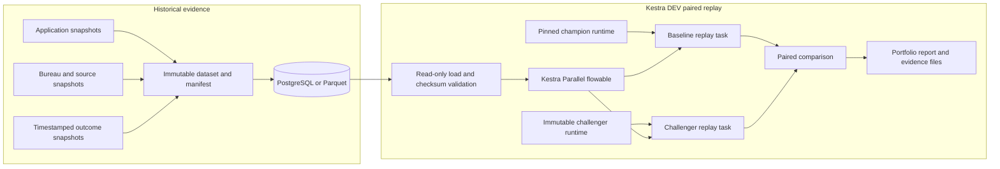

# Historical data and DEV portfolio replay

This document explains the historical-data contract, storage layout and replay controls. The runnable operator workflow is in [End-to-end DEV workflow](end-to-end-dev-workflow.md); all multi-command shell procedures are implemented in `tools/guides/workflow/` and invoked there one step at a time.

## Architectural responsibility

**Kestra orchestrates. Python executes. UWflow decides. AIDflow scores. The historical data layer supplies point-in-time evidence.**

| Component | Owns | Must not own |
|---|---|---|
| Historical connectors | Reading/writing governed immutable point-in-time snapshots | Underwriting decision logic or workflow scheduling |
| Synthetic generator | Deterministic synthetic portfolios, seed and generator provenance | Risk calibration or observed repayment evidence |
| UWflow runtime | Underwriting calculations and decisions | Historical database connectivity |
| Kestra | Validation, task dependencies, parallel replay, retries and artifact collection | SQL queries or record-level credit calculations |
| Replay tools | Pinned runtime loading, batch evaluation, comparison and provenance | Workflow scheduling or storage-specific underwriting policy |

The Kestra metadata database is separate from the UWflow historical PostgreSQL database. The history connector has no direct dependency on the underwriting decision engine. Kestra starts Python tasks; the Python adapter reads the historical case contract and runs the selected immutable runtime.

## Historical replay data path

## PostgreSQL storage model

PostgreSQL runs separately in container `uwflow-history-db`, database `uwflow_history`, host port `55432`, and persistent Docker volume `uwflow_history_pgdata`. It is attached to local Docker network `uwflow-local`. Kestra uses its own metadata storage and volumes; these databases must not be conflated.

| Schema | Main tables | Responsibility |
|---|---|---|
| `history` | `application_snapshots`, `decision_snapshots`, `canonical_case_payloads` | Application snapshots, any original recorded decisions, exact canonical case payloads |
| `sources` | `bureau_snapshots`, `alternative_data_snapshots` | Point-in-time source observations |
| `outcomes` | `credit_outcomes` | Separately timestamped repayment/outcome evidence |
| `simulation` | `dataset_manifests` | Immutable dataset manifest and checksum |

Three database identities are created explicitly by the admin bootstrap:

| Identity | Privileges | Purpose |
|---|---|---|
| Owner/admin | DDL and role/bootstrap administration | Schema and table creation only |
| `uwflow_history_writer` | SELECT and INSERT | Writing new immutable dataset IDs |
| `uwflow_history_reader` | SELECT only | Validation and replay |

The application writer cannot UPDATE or DELETE an existing dataset. Schema creation is performed only by `tools/history/database/initialize.py` with the admin DSN and explicit write acknowledgement. Run the packaged `10-initialize-history-database.sh` workflow step when bootstrapping a new database or when a package adds a required schema/table. The script activates `var/venv` itself, including in a newly opened terminal.

## Canonical PostgreSQL payload and checksum integrity

PostgreSQL retains decomposed JSONB tables for relational filtering and inspection. The connector also writes the exact canonical JSON representation of each full `HistoricalCase` to `history.canonical_case_payloads.payload_json` (PostgreSQL `TEXT`). The immutable manifest marks this representation as `canonical_payload_format: json-v1`.

The writer calculates SHA-256 using the canonical case contract and writes both the canonical text and query-friendly projections inside one database transaction. The reader retrieves the exact text payload, reconstructs the `HistoricalCase`, and verifies that its fields agree with the decomposed tables before yielding it to the validator or replay worker. The independent validator streams those returned cases and recalculates the dataset digest.

This avoids depending on JSONB's internal serialization order/format to reproduce Python's canonical JSON bytes. It also provides a consistency check between the canonical source payload and the decomposed tables. If either representation is incomplete or disagrees, the connector fails closed rather than quietly continuing.

The History connector accepts only the current dataset contract: manifest schema v1, case schema v2 and `canonical_payload_format: json-v1`. Every application must have an exact canonical JSON payload, and the connector verifies that payload against the decomposed query tables before returning it. Missing schema identifiers, unsupported schema versions, absent payloads or mismatched projections are hard errors. The connector does not reconstruct cases from relational rows or infer omitted fields. Datasets that do not meet this contract must be exported and explicitly transformed into a new immutable dataset using a reviewed migration process outside the replay path. The current operator workflow creates a `synthetic-eur-v4-fstpd30-...` dataset and validates it immediately after write; `v4` identifies the generator contract, while `canonical_payload_format` identifies the storage contract.

## Parquet connector

The Parquet adapter stores case data as partitioned, immutable dataset snapshots beneath the configured history root. It uses the same `HistoricalCase` and `DatasetManifest` contract and the same canonical digest. PyArrow is loaded only when the Parquet connector is selected. The full development extra used by the workflow installs the optional Parquet dependency.

PostgreSQL and Parquet are alternate storage adapters, not different underwriting or replay semantics. They must return the same historical case contract and enforce the same point-in-time validation rules.

## Dataset manifest and reproducibility

A dataset manifest records:

- Dataset ID and immutable creation identity.
- Case count and case/manifest schema versions.
- Generator name/version, seed, as-of date and historical window for synthetic data.
- Synthetic flag and explicit outcome-label limitations.
- Canonical SHA-256 content digest.
- Connector and relevant generation metadata.

The dataset ID is write-once. Re-running a generator with the same ID must fail rather than replace a prior dataset. Use a new ID when changing seed, generator version, as-of date, history window or canonical payload format.

## Point-in-time and case contract

A historical case can include:

- Pseudonymous application ID and application snapshot identity.
- Application and decision timestamps.
- Application payload and segments.
- Bureau snapshot with its retrieval/observation time.
- Zero or more alternative-data snapshots, each with source identity and retrieval time.
- An optional outcome snapshot and its observation/maturity time.
- An optional original recorded-decision snapshot for genuine historical cases.

Every source snapshot supplied for a decision replay must have been available no later than the original decision timestamp. Replay must not query live bureau or alternative-data providers to fill historical gaps. If the source was not collected at the time, it remains missing; do not manufacture an observation.

For real historical datasets, use a stable pseudonymous application key. Do not include direct identifiers, names, national IDs, addresses, account numbers or unnecessary personal data. Confirm lawful basis, encryption, retention, access segregation and data-minimisation requirements before using customer data.

## Synthetic outcome limitations

The synthetic generator creates deterministic examples for software validation. Its outcomes are counterfactual fixtures for testing pipeline behaviour and maturity/censoring logic. They are generated independently of approval, booking and loan take-up; they are not realised repayment performance, calibrated PDs or evidence that one policy is safer than another.

Synthetic replay can demonstrate which decisions change, which segments are affected, and whether scores, prices, amounts and reason codes are reported consistently. It cannot answer what actual credit performance would have been. That requires genuine booked-loan outcomes, sufficiently matured observation windows and explicit treatment of take-up, censoring and cohort selection.

## Replay execution

The paired replay flow is manual-only in `com.ai.credit.dev`. It performs these tasks:

1. Validate the selected dataset and checksum.
2. Run the frozen baseline runtime over the chosen offset/limit.
3. Run the candidate runtime over exactly the same cases.
4. Compare paired output rows and write decision migration, case-level and aggregate evidence.

The baseline and candidate tasks use exact immutable runtime paths and pinned manifest digests. The generated Kestra flow records the baseline release, candidate ID, history-tools bundle and runtime manifest hashes. It never promotes a candidate to PROD.

The operator guide first performs a local no-op replay and then a 100-case Kestra smoke replay before allowing the full portfolio. Keep the same dataset ID, baseline, offset and case limit across a controlled comparison.

The comparison task also writes the analyst/CRO deliverables described in [Champion vs Challenger impact report](champion-challenger-impact-report.md): a PDF and self-contained HTML report, plus CSV evidence for case-level changes, final-decision migration, stage outcomes, AIDflow score deciles, applicant segments and ten-source coverage. The report treats `APPROVED` as strict approval and `APPROVED + COUNTEROFFER` as the broader offer population. FSTPD30 rates always include matured-label denominators and coverage; synthetic labels are counterfactual software-test data, not observed credit performance.

## Common operator commands

Use the one-line wrappers in [End-to-end DEV workflow](end-to-end-dev-workflow.md):

- Create/reuse credentials: `bash tools/guides/workflow/04-create-history-credentials.sh`
- Start PostgreSQL: `bash tools/guides/workflow/06-start-history-database.sh`
- Initialise schema and roles: `bash tools/guides/workflow/10-initialize-history-database.sh`
- Select, create and validate a dataset: `bash tools/guides/workflow/11-select-or-create-dataset.sh`
- Stop PostgreSQL without deleting its volume: `bash tools/guides/workflow/21-stop-history-database.sh`

Do not use `docker compose down -v` for ordinary shutdown. It removes persistent volume data.
