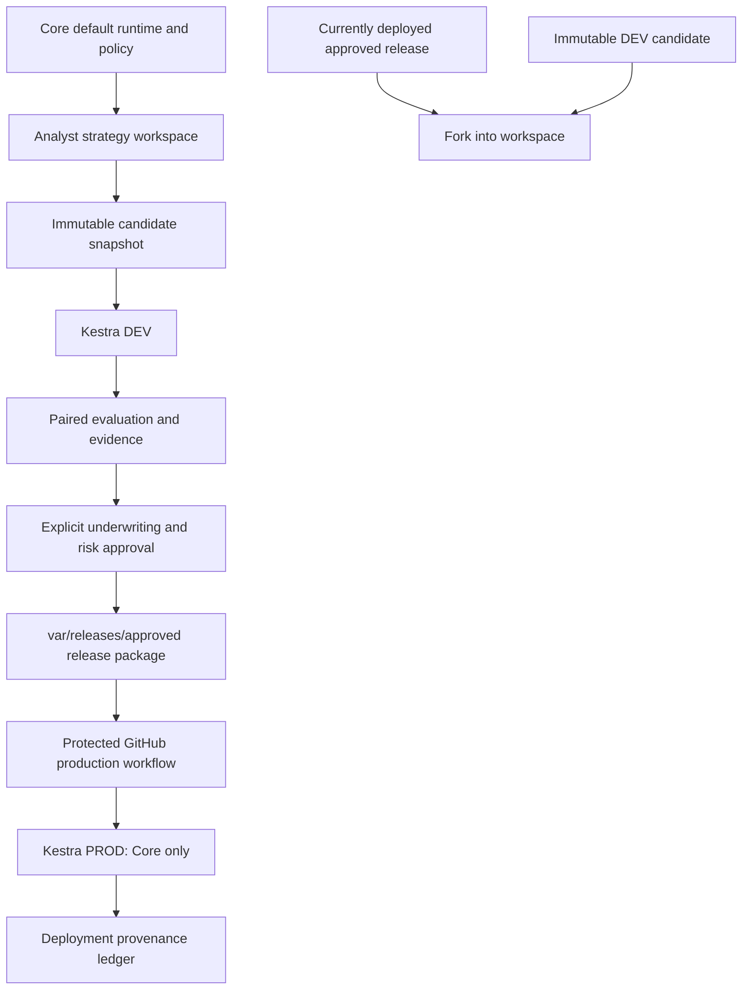

# Governed release boundary

Production deployment is a controlled promotion of an already evaluated immutable candidate. The platform distribution version, Core runtime, strategy, candidate and approved release have separate identities.


For the complete workspace-to-deployment lifecycle and canonical storage model, see [UWflow lifecycle and storage model](../architecture/lifecycle-and-storage.md).

## Lifecycle



## Ownership and write boundaries

- `core/` is the autonomous seven-stage underwriting engine and its untouched default policy. Modules never write here.
- `modules/` contains platform source code.
- `var/workspaces/strategies/` contains mutable analyst policy specifications and workspace metadata.
- `var/artifacts/candidates/` contains immutable DEV runtime snapshots, policy specs, manifests and manual-only candidate flows.
- `var/artifacts/evaluations/` contains immutable evaluation evidence.
- `var/releases/approved/` contains immutable production deployment packages assembled only after explicit approval.
- `var/deployments/production/` records what deployment automation reports as deployed. The workflow retains its ledger as a GitHub Actions artifact; it does not automatically sync live deployment state to each analyst checkout.

## Analyst workflow

Start Policy Studio and select an existing workspace, create a blank workspace from Core's default policy, or fork an immutable candidate/approved release. Forking copies canonical strategy specifications into a new workspace and records the exact parent artifact manifest hash. The source artifact is never modified. The workspace pins its selected Core runtime identity; candidate creation packages a complete snapshot.

Studio saves policy specifications and generated preview code only under the selected workspace. It never writes Core policy files or `core/python/runtime/policy_generated.py`.

## Build and evaluate a candidate

1. Select the exact baseline release currently deployed in PROD.
2. Select the strategy workspace and build a candidate through Studio/Lifecycle.
3. Candidate files are written under `var/artifacts/candidates/<candidate-id>/`. Candidate creation does not call Kestra or production.
4. Publish the candidate and baseline to `com.ai.credit.dev` using the generated manual DEV commands.
5. Run the paired replay against the same frozen historical dataset. Store evaluation evidence under `var/artifacts/evaluations/<evaluation-id>/`.
6. Register the replay output directory as an immutable evaluation artifact. It must contain `comparison.json` and the replay's evidence outputs:

   ```bash
   python -m modules.evaluation.tools.register_evaluation --evaluation-id eval-2026-001 --candidate dev-0123456789abcdef --baseline-release 2.0.0 --dataset-id synthetic-eur-v4-example --source-dir var/reports/history-comparison
   ```

7. Record the approval attestation as JSON. It must include `status: approved`, exact `candidate_id`, `candidate_manifest_sha256`, `evaluation_id`, `approved_by` and `approved_at`. This JSON is an attestation record, not a cryptographic signature or authenticated user identity; `approved_by` is not an RBAC control. The underlying business approval must come from the institution's authorised approval process.

Candidate source provenance records the source Git commit and whether the `core/` subtree was clean at build time. The builder does not authenticate branch protection; the approved package must subsequently be committed through review to protected `main`, and deployment refuses dispatch from any other ref. Candidates built from dirty or unverified Core source are useful DEV experiments but are ineligible for production promotion.

## Assemble an approved release

The release assembler verifies candidate runtime/artifact hashes, policy hashes, the exact production-flow template, the evaluation manifest and every evidence-file checksum, matching candidate/baseline/dataset identities, and the approval attestation. It requires a digest-pinned OCI image reference (`repository@sha256:<64 hex>`). It copies the tested runtime and strategy into `var/releases/approved/<release-id>/`, renders the production flow against that exact runtime, and writes a release manifest. Existing release paths are never overwritten.

Example:

```bash
python -m modules.production.tools.release.assemble_approved_release --candidate dev-0123456789abcdef --release-id 2.0.1 --approval approval.json --image-reference ghcr.io/example/uwflow-core-runtime@sha256:REPLACE_WITH_DIGEST
```

The evaluation directory and approval JSON must already exist. The supplied release ID is the approved release identity; it is not inferred from the candidate or platform version. The command assembles files locally; it does not deploy.

## Deploy

After assembly, include the approved package and its required references in a reviewed change to protected `main`. Production deployment is a manually dispatched GitHub Actions workflow from that branch. It accepts an exact release ID and refuses to proceed unless the corresponding approved directory, approval record, release manifests, runtime checksums and immutable image reference verify. It uploads only `var/releases/approved/<id>/runtime/` and deploys only that release's `production-flow.yaml` to `com.ai.credit.production`.

Platform semantic-version tags may be used for source/package release management, but they do not deploy underwriting production. Kestra credentials remain GitHub environment secrets. Namespace Files upload is non-overwriting; flow update is allowed only after the release has passed the approval and manifest checks.

## Deployment ledger and rollback

After successful deploy steps, the workflow records the release ID, release manifest hash, GitHub run and commit in `var/deployments/production/history/`, and updates `var/deployments/production/current.json`. A rollback is a new deployment of a previously approved immutable release, not an edit to the current release.

## Important operational limitation

A successful local build and CI run do not prove the remote Kestra deployment. Before first production use, validate the Kestra CLI/action behavior, Namespace Files paths, flow validation and actual runtime/image identities against a non-production Kestra instance. Production remains gated by the GitHub `uwflow-production` environment.
