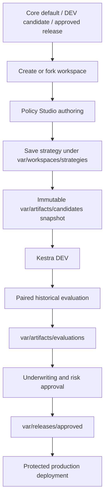

# Policy Studio: workspace and DEV candidate lifecycle

Policy Studio is an analyst authoring environment. It edits mutable strategy workspaces and never changes Core source. Lifecycle packages a selected workspace with its pinned Core runtime and execution contract into an immutable candidate.

For canonical object identities, storage ownership and immutability rules, see [UWflow lifecycle and storage model](../architecture/lifecycle-and-storage.md).

## Lifecycle diagram

## Analyst workflow

1. Start Studio using `bash tools/guides/workflow/15-start-studio.sh`.
2. Select an existing strategy workspace, create a new workspace from Core's default policy, or fork an immutable DEV candidate / approved release.
3. Edit the currently supported Stage 1 or Stage 3 policy, validate it and inspect the generated Python preview.
4. Save. The canonical policy and generated preview are written only under `var/workspaces/strategies/<workspace-id>/`.
5. Select the exact baseline release currently deployed in PROD and build a DEV candidate.
6. Publish the generated candidate and baseline commands only to `com.ai.credit.dev`.
7. Run the paired replay against the same frozen historical dataset and retain its evidence under `var/artifacts/evaluations/`.

## Workspace semantics

- **Continue workspace** reopens the same mutable analyst work.
- **Create workspace** starts from Core's default strategy without modifying Core.
- **Fork candidate** copies the exact canonical policy specifications from an immutable DEV candidate and records the candidate manifest hash and parent workspace identity.
- **Fork approved release** copies the exact policy specifications from an immutable approved release and pins its Core runtime and production-flow contract.

A fork is independent. Editing it never changes its source. The source selector lists available candidates and approved releases; the analyst does not need to copy files or understand repository paths. The currently deployed PROD release is highlighted when `var/deployments/production/current.json` is synchronized locally or `UWFLOW_CURRENT_PROD_RELEASE` is set in `.env`. The deployment workflow retains this pointer as a workflow artifact; it does not silently claim that a local checkout knows the live Kestra state.

## Candidate contents and ownership

A candidate is written under `var/artifacts/candidates/<candidate-id>/` and contains the runtime modules, canonical policy specs, candidate manifest, artifact manifest, selected production-flow template and manual-only DEV candidate flow. Candidate creation is local-only: it does not publish Namespace Files, deploy Kestra, approve a release or alter production.

Candidate identity includes the exact workspace, selected Core runtime module hashes, baseline runtime manifest, strategy policy hashes, source reference and flow-template identities. The protected Core tree status is recorded. A candidate built from a dirty or unverified Core tree remains usable for DEV experimentation but cannot pass the production release assembler.

The `core/` directory remains unchanged by Studio and Lifecycle. Generated policy preview code lives in the workspace; the candidate compiler output is included in the immutable candidate runtime bundle.

## Evaluation and promotion

After the candidate is published to DEV, Evaluation runs the champion and challenger against the same fixed historical dataset. Reporting produces evidence. An authorised underwriting/risk approver records an explicit attestation referencing the exact candidate manifest and evaluation ID. Only then can the Production module assemble `var/releases/approved/<release-id>/`.

See [Governed release boundary](../production/production-release-workflow.md) for approval, assembly, deployment and rollback.
