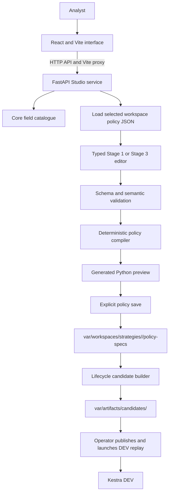

# Policy Studio — local authoring guide

The Policy Studio is the analyst interface for independent strategy workspaces. It edits workspace-owned copies of the currently supported Stage 1 and Stage 3 policies. It provides typed editors, server-side validation, generated-Python preview, local workspace saves and immutable DEV candidate preparation. Core's canonical default policies and runtime are read-only to Studio.

The Studio does not execute underwriting, orchestrate replays, upload Namespace Files or deploy production. Kestra remains the workflow engine; Python remains the policy execution runtime.

## Policy Studio data flow



The Studio owns analyst workspaces, authoring, validation and local candidate preparation. It reads Core's field catalogue and default strategy, but all edits and generated preview code are saved under `var/workspaces/strategies/<workspace-id>/`. It does not execute underwriting, schedule replay, publish Namespace Files or deploy PROD; the operator and Kestra own those steps. Modules remain a development/governance control plane and are not deployed into the PROD underwriting execution path.


## What you can edit

| Stage | Responsibility | Studio support |
|---|---|---|
| Stage 1 — Hard Gates | Input validity, age, income, employment, requested amount and loan term | Editable typed policy with six positive predicates |
| Stage 3 — Source Planning | Hard-gate result, bureau status and consent determine the ten-source plan | Editable routing graph |
| Stages 2 and 4–7 | Bureau policy, source execution, AIDflow inference, final decision and report rendering | Displayed as runtime-owned stages |

Stage 1 derives `PASS` when a rule's `valid_when` predicate matches and `FAIL` with its configured reason code otherwise. Stage 3 returns a typed plan or a no-collection outcome. It does not perform source calls or create Kestra tasks.

## Start the Studio

The Policy Studio runs as two Docker Compose services: a FastAPI API and a React/Vite frontend. The API mounts the current repository read/write so strategy workspaces and immutable DEV artifacts persist in the checkout. Core source is treated as read-only by the Studio API. The frontend source is mounted read-only at `/workspace/frontend`; Node dependencies and Vite's optimizer cache live in the persistent external volume `uwflow_studio_node_modules`, mounted at `/workspace/node_modules`. Vite is explicitly configured to store its cache at `/workspace/node_modules/.vite`, never beneath the read-only source tree. Node.js and npm are not installed on the host.

The Compose project is explicitly named `uwflow-studio`, independent of the extracted repository folder name. The launcher manages only services belonging to that Compose project and never searches for, stops or removes containers from other project names. It does not use fixed `container_name` values. If an old container or unrelated service occupies a required host port, resolve that conflict explicitly; the launcher will not guess which other container is safe to remove. The frontend dependency volume is declared external and is preserved by ordinary `compose down`.

Open a terminal in the UWflow repository root and run:

```bash
bash tools/guides/workflow/15-start-studio.sh
```

Open the frontend at [http://127.0.0.1:5173](http://127.0.0.1:5173). The API documentation is available at [http://127.0.0.1:9000/docs](http://127.0.0.1:9000/docs). The ports can be changed in the local environment configuration.

The services bind to loopback. Before startup completes, the operator script verifies API health, frontend health, the React entry page, the transformed `main.tsx` and `App.tsx` modules, the API stage catalogue and the frontend-to-API proxy. The catalogue must expose seven stages with only Stage 1 and Stage 3 editable. The Studio has no user authentication or multi-user authorization; keep it on the local machine and do not expose it to a LAN or public network.

The default browser address is `http://127.0.0.1:5173`; the API is `http://127.0.0.1:9000`. Docker container IP addresses are internal and can change when the project is recreated. Set `UWFLOW_STUDIO_WEB_PORT` and `UWFLOW_STUDIO_API_PORT` in `.env` to change the host-side ports.

### Display preferences

Select **Display** in the top bar to open personal appearance settings. The Studio provides four themes:

| Theme | Appearance |
|---|---|
| Black | Deep neutral black surfaces |
| Navy | Original UWflow blue-grey workspace |
| Pro White | White surfaces with dark text |
| Neat Silver | Soft silver-grey surfaces |

Text size can be set to Compact (100%), Comfortable (115%), Large (130%) or Extra large (145%). The selected theme and text size apply immediately and are saved in the current browser's local storage. They are browser-specific presentation preferences, not workspace policy settings: they are not written to the repository, policy JSON, candidate manifests or runtime configuration. Reset defaults restores Navy and Comfortable.

The Stage 1 Hard Gates editor and its action toolbar use the available content width. At larger text sizes, toolbar actions wrap rather than compressing their labels. The display settings are available on every stage and can be changed without discarding policy edits.

### Container lifecycle and diagnostics

The start/build/stop scripts all use the same explicit Compose project name and the same external dependency volume. The launcher manages only services belonging to the `uwflow-studio` project; it does not search for, stop or remove containers from other project names. It does not use fixed `container_name` values. If an old container or unrelated service occupies a required host port, resolve that conflict explicitly; the launcher will not guess which other container is safe to remove. The external dependency volume is preserved by ordinary `compose down`.

Inspect the stable Studio project with:

Inspect the stack with `docker compose --project-name uwflow-studio -f docker-compose.studio.yml ps`; inspect recent output with `docker compose --project-name uwflow-studio -f docker-compose.studio.yml logs --tail 100`.

The frontend dependency volume also contains Vite's optimizer cache at `/workspace/node_modules/.vite`. If the frontend cannot write to this directory, the entrypoint stops with a volume-permission error rather than falling back to a cache directory beneath the read-only source mount.

Stop the Studio with:

```bash
bash tools/guides/workflow/16-stop-studio.sh
```

Stopping the services uses the same fixed Compose project and does not remove the repository, the external `uwflow_studio_node_modules` dependency/cache volume or the PostgreSQL history volume.

## Authoring workflow

1. Select **Stage 1 — Hard Gates** or **Stage 3 — Source Planning**.
2. Edit the rule predicates or routing graph using the fields, operators and source IDs exposed by the policy catalogue.
3. Select **Validate**. The API validates the submitted policy and compiles the generated Python in memory.
4. Inspect **Python preview** and the generated policy hashes.
5. Select **Save policy**. The Studio writes the workspace's canonical JSON and generated Python preview only to `var/workspaces/strategies/<workspace-id>/`.
6. Review the workspace diff. Core policy files and the Core runtime must remain unchanged.

The save operation uses the SHA-256 value from the loaded workspace policy to detect stale edits. If the on-disk workspace policy changed after it was loaded, the API rejects the save with HTTP 409 rather than overwriting the newer file.

Verify the saved policy and run repository checks with:

```bash
bash tools/guides/workflow/17-verify-policy-save.sh
```

## Build a DEV candidate

Before editing, choose the source of the strategy workspace:

- **Create workspace** starts from a copy of Core's default Stage 1 and Stage 3 policies.
- **Fork candidate** starts from any available immutable DEV candidate.
- **Fork approved release** starts from any available approved production release, including the currently deployed release when its pointer is synchronized.
  The source packages are immutable directories under `var/releases/approved/<release-id>/`; the workspace records the source manifest hash and pinned runtime/flow-template paths rather than copying the release bundle.

The fork creates a new independent workspace, copies only its editable policy specifications, and records the source manifest hash, parent workspace and pinned Core runtime/flow-template paths. It does not copy or mutate the source candidate or release.

After saving and validating the policies:

1. Select the exact baseline runtime release to compare against. For a current champion/challenger decision, use the `runtime-release` label from the live PROD flow.
2. Confirm the selected workspace and baseline identity.
3. Select **Build DEV candidate**.
4. Record the candidate ID and review the generated manifest and deployment commands. The candidate builder does not allocate a production release ID.

The builder creates a content-addressed runtime directory under `var/artifacts/candidates/` and a manual-only candidate flow under `var/artifacts/candidates/<candidate-id>/candidate-flow.yaml`. It may also create the corresponding manual-only baseline flow for the selected release.

Candidate creation is a local file-generation action. It does not contact Kestra, upload Namespace Files, run an execution, assign an approved release ID, create a Git tag or deploy production. Follow the [Policy Studio DEV lifecycle](policy-studio-dev.md) to publish the baseline and candidate, deploy the DEV flow and run a controlled replay.

## Validation and safety

The API and compiler are authoritative. UI field controls are an editing aid, not a security boundary. The compiler rejects unknown fields, unsupported operators, invalid types, malformed graph topology and unregistered source IDs. Arbitrary analyst Python is not accepted or executed.

The Studio changes the selected workspace only. Core's default policy/runtime files and immutable source candidates/releases are not writable through Studio. Published candidate and approved-release directories are immutable. Candidate paths are content-addressed; a changed policy, runtime source or flow template creates a new candidate identity rather than rewriting an existing candidate.

## Current limits

- Stage 2 bureau rules and Stage 6 decision, affordability and pricing parameters are not yet editable in the Studio.
- AIDflow remains a separate deterministic demonstration scorer; its inference inputs and scoring logic are not edited through this interface.
- Candidate replay is launched through the separate Kestra DEV workflow. The Studio prepares the candidate and displays the related commands; it is not a second workflow orchestrator.
- The interface is a single-user local development tool. Authentication, RBAC, multi-user editing and approval workflows are not implemented. The source selector is not a permission boundary.
- The deployment workflow does not silently synchronize `var/deployments/production/current.json` into every checkout. Set `UWFLOW_CURRENT_PROD_RELEASE` in `.env` or synchronize the deployment pointer when the current PROD release should be highlighted locally.

For the complete database, replay and policy-change walkthrough, see [End-to-end DEV workflow](../development/end-to-end-dev-workflow.md).

## Startup diagnostics

The detached Studio launcher checks the API, frontend and frontend-to-API proxy. If Docker Compose cannot start either service, it prints the service status and the last 150 lines from both container logs before stopping. For a later investigation, run `bash tools/guides/workflow/90-diagnostics.sh`; it includes stopped as well as running Studio containers and their recent logs.
